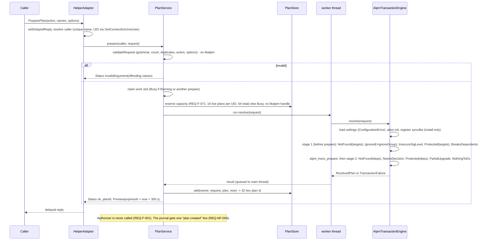

# Package helper transactions — DESIGN (HoloNight Packages)

Spec: `docs/sdd/package-helper-transactions/SPEC.md` (74 functional, 6 non-functional, 15 constraint requirements, 24 error codes, open items OI-01..OI-17). Status: draft for user review, reconciled with the SPEC revision of 2026-11-09. The SPEC is authoritative. The user has decided OI-04, OI-05, OI-07, OI-08, OI-11, SI-9, SI-12 and SI-14 (marked **DECIDED** in sections 11.4, 16 and 17); the SPEC already carries the edits that section 17 asked for. OI-10, OI-14, OI-16 and OI-17 stay open until the spikes of section 12.6.

Facts about libalpm that are visible in `/usr/include/alpm.h` (pacman 7.1.0 on this machine) are stated as facts. Facts about libalpm internals that the header does not show are marked **(spike)** and are retired by the spikes in section 12.6 before the implementation plan is frozen.

## 0. Findings from the existing code and from libalpm that shape the design

| # | Finding | Consequence |
|---|---|---|
| F1 | libalpm does not parse `pacman.conf`. The header has no parser; `pacman` and `pacman-conf` parse it in the frontend and call `alpm_option_*` / `alpm_register_syncdb`. The repo already has that parser: `src/backends/src/pacman_config.{h,cpp}` (IgnorePkg/IgnoreGroup) and `pacman_repositories.{h,cpp}` (`[repo]`, `Server`, `Include`, `$repo`/`$arch`, `SigLevel` with `parseSigLevel`, `GPGDir`, `Architecture`, fail-closed). | SPEC REQ-F-019/039/040 ("as parsed by libalpm", "no custom SigLevel parser") cannot hold literally. Design: the helper reuses and extends the existing parser, passes the result to libalpm, and **reads the effective level back** with `alpm_db_get_siglevel`. Spec issue SI-1. |
| F2 | `ALPM_TRANS_FLAG_NOLOCK` (1 << 17) exists in this header. The header says the lock file "is created when committing a transaction and released when the transaction completes". So `alpm_trans_prepare` runs unlocked. | REQ-F-046 (lock from re-resolution through the end) needs the helper to own the lock (`DatabaseLock`, `NOLOCK` transaction). SI-4. |
| F3 | All downloading, key checks, integrity checks, file-conflict and disk-space checks, and PreTransaction hooks run inside `alpm_trans_commit` (the header documents that `alpm_trans_commit` downloads; events `PKG_RETRIEVE_*`, `KEYRING_*`, `INTEGRITY_*`, `LOAD_*`, `FILECONFLICTS_*`, `DISKSPACE_*`, `HOOK_START(when)`, `TRANSACTION_START`, `PACKAGE_OPERATION_*` are all commit-phase events). **(spike S-1)** for the exact order. | REQ-F-057 ("commit point = start of the first commit call") contradicts REQ-F-056 and its own acceptance criteria. The design defines the commit point by event (section 6.7). SI-2, SI-3. |
| F4 | `alpm_trans_interrupt` is ignored before `TRANSACTION_START`, and neither it nor SIGINT stops a running download (spikes S-1, S-2). | Cancel before the commit point ends the helper process after replying `Cancelled` (section 6.8). SI-10. |
| F5 | The question callback has typed answers: `install`, `replace`, `remove`, `remove` (corrupted), `skip`, `use_index` (provider, an index, not a yes/no) and `import`. | "Safe default no" does not exist for `SELECT_PROVIDER`; the design detects choices during prepare (section 6.5). SI-6. |
| F6 | A corrupted-package question only asks whether to delete the file. libalpm does not re-download inside the same commit **(spike S-5)**. | REQ-F-055 needs a helper-level retry of the whole execution (section 6.6). SI-5. |
| F7 | libalpm exposes no HTTP status. `alpm_cb_download` completion carries only `result` (0, 1, -1); the final error is `ALPM_ERR_RETRIEVE`. curl reports a missing and an unreadable `file://` file with the same error **(spike S-4)**. | Stale-mirror classification (REQ-F-028/029, OI-10) needs a table over libalpm log text plus a local `stat` for `file://` servers (section 10.3). SI-7. |
| F8 | libalpm has no public API for "which hooks will run". | Hook preview (REQ-F-002, REQ-F-043) needs a small hook-file reader in the transaction library (section 7.3). SI-8. |
| F9 | libalpm runs hooks and scriptlets through `chroot(root)` **(spike S-3)**. A non-root test process gets `EPERM`. | Tests with hooks or scriptlets need a user-namespace re-exec (section 12.5). SI-9. |
| F10 | `check-layering.py` already enforces: `ALPM_NAMES` outside `src/backends` and the two composition roots (C-001), `alpm_trans_*` and `pacman -[SUR]` everywhere in `src apps qml tests` (C-005), one `alpm_pkg_vercmp` user (F-007), no pointer/keyboard input in tests (C-010), `Server = non-file://` in tests (C-006), and exactly one `CARVE_OUT` line in `AGENTS.md`. | The script and its fixture test must be extended; see section 3.5. |
| F11 | `holonight_packages_application` already has `Clock`, `OneShotTimer`, `SystemClock`, `QtOneShotTimer` (`update_check_ports.h`, `update_check_runtime.h`) and `tests/application/fake_clock.h` (`FakeClock`, `FakeTimer`). `MtRandomSource` is a Mersenne twister. | Reuse `Clock` and `OneShotTimer` for plan expiry and the idle timer. Plan IDs must come from a new CSPRNG-backed port, not `RandomSource`. |
| F12 | `apps/packaged` pattern: static lib `holonight_packaged_service` (adaptor + service) + thin `main.cpp`; XML at `apps/packaged/dbus/*.xml` exposed through a compile definition and embedded as `Q_CLASSINFO("D-Bus Introspection")`; `*.service.in` configured with `@ONLY`; tests start `PrivateBus` (`tests/packaged/private_bus.h`). | The helper copies this pattern under `apps/helper`. |
| F13 | `tests/CMakeLists.txt` keeps a libalpm-free `test_holonight_packages_checks` (guarded by `holonight_packages_checks_no_libalpm`) and the big `test_holonight_packages`. | New pure code (plan model, store, service) goes into the checks executable; libalpm code gets its own executable. |
| F14 | pacman 7 has `DownloadUser`/sandbox: libalpm drops privileges for downloads when `alpm_option_set_sandboxuser` is set (root). | The parser must also read `DownloadUser` and `DisableSandbox*` and pass them on (section 6.1). |
| F15 | `XferCommand` is implemented by the pacman frontend through `alpm_option_set_fetchcb`, not by libalpm. | The helper never sets a fetch callback in production, so `XferCommand` is ignored (REQ-C-003). A test seam may set one (section 12.3). |

## 1. Overview of the approach

```
caller (GUI / packaged)              system bus                      holonight-package-helper (root, bus-activated)
  PreparePlan(action,names,{}) ───────────────────────────►  HelperAdaptor ─► PlanService (application, Qt Core)
                                                                              │ validate (domain, no libalpm)
                                                                              │ claim work slot, worker thread
                                                                              ▼
                                                                  TransactionEngine port ─► AlpmTransactionEngine (STATIC lib, no Qt D-Bus)
                                                                                              resolve() = prepare only, NOLOCK, read-only
                                                                              ▲
  Execute(planId) ────────────────────────────────────────►  PlanService
        │                                                       │ lookup+bind (unique name, UID) ─► PlanStore
        │                                                       │ Authorizer port ─► PolkitAuthorizer ─► org.freedesktop.PolicyKit1
        │                                                       ▼ allowed
        │                                                  engine.execute(): DatabaseLock ► re-resolve ► samePlan? ► commit
        │ ◄── Progress (unicast to owner) ◄──────────────────── ProgressSink (queued to main thread)
        ▼ delayed reply: Result
```

The caller sends only an action and names. The helper owns the plan, the check order, the lock, the equality test and the commit. D-Bus and polkit code is confined to `apps/helper`. libalpm code is confined to `src/backends` and `src/transaction`.

## 2. Scope notes

No change under `qml/` or `apps/packages` (REQ-C-013). `apps/packaged` is unchanged. `src/platform` and `src/advisor` stay INTERFACE stubs. The existing `holonight_packages_backends` keeps its API; one new STATIC target is split out of it (section 3.2).

## 3. Components, module layout and link direction

### 3.1 Resolution of OI-02 (code location)

| Question | Decision | Why |
|---|---|---|
| Where does the transaction core live? | New directory **`src/transaction`**, target **`holonight_packages_transaction`** (STATIC), namespace `holonight_packages_transaction`. | REQ-C-001 names the target. `src/backends` holds read-only `Alpm*Source` adapters and `AlpmUpdateChecker`; a mutating transaction engine with a lock, callbacks and signal handling has a different risk profile and must be greppable on its own by the layering script. |
| Where does the plan model live? | **`src/domain`**: pure value types, request validation, plan equality (`samePlan`), error codes, progress/result types, and the `TransactionEngine` port. | Dependencies point toward `domain`. Plan equality (REQ-F-043) and name validation (REQ-F-013) are pure and unit-testable with no libalpm. |
| Where does resolution logic live? | **Inside `holonight_packages_transaction`** (`PlanResolver`), because it drives `alpm_trans_prepare` and reads `alpm_trans_get_add/remove`. | A libalpm-free resolver would have to re-implement dependency resolution (conflicts, providers, replaces) which REQ-C-004 spirit and risk 1/2 argue against. `src/application` must not include libalpm (REQ-C-002). |
| Where does orchestration live (plan store, expiry, binding, authorization order, busy slot, idle)? | **`src/application`** (`PlanStore`, `PlanService`, `IdleMonitor`, port `Authorizer`). No libalpm, no QtDBus types. | Testable in the libalpm-free checks executable with `FakeClock`, a fake `Authorizer` and a fake `TransactionEngine`. |
| Where do D-Bus and polkit live? | **`apps/helper`** only. | REQ-C-002, REQ-C-007. |
| Does `src/platform` become STATIC? | **No.** It stays an INTERFACE stub. | Nothing in this feature is a platform adapter. The only candidate (signal bridge) is 40 lines and `src/platform` currently links `Qt6::DBus` and `Qt6::Gui` in its INTERFACE, which would silently hand D-Bus to any consumer and weaken REQ-C-002. The helper gets its own `HelperSignals` (SIGTERM/SIGINT to Qt signal), duplicating `apps/packaged/SignalHandler` knowingly. A later refactor may move both into a STATIC platform target after its INTERFACE link list is cleaned. |

### 3.2 New and changed files (`+` new, `~` edited)

```
src/domain                                  target holonight_packages_domain (std only, Qt Core PRIVATE as today)
  +include/holonight_packages_domain/transaction_request.h      PlanAction, PlanRequest, validateRequest(), isValidPackageName()
  +include/holonight_packages_domain/transaction_error.h        TransactionErrorCode (24 codes), transactionErrorName(), TransactionFailure
  +include/holonight_packages_domain/transaction_plan.h         ChangeKind, PlannedChange, HookPreview, ResolvedPlan, samePlan()
  +include/holonight_packages_domain/transaction_progress.h     ProgressPhase, ProgressUpdate, ProgressSink
  +include/holonight_packages_domain/transaction_result.h       ExecutionOutcome, ChangedPackage, WarningToken (HookFailed), ExecutionResult
  +include/holonight_packages_domain/transaction_engine.h       port TransactionEngine, ExecutionControl, CancelResult
  +src/transaction_request.cpp, transaction_error.cpp, transaction_plan.cpp
  ~include/holonight_packages_domain/holonight_packages_domain.h (includes)   ~CMakeLists.txt

src/application                             target holonight_packages_application
  +include/holonight_packages_application/authorizer.h          port Authorizer, AuthorizationRequest, AuthorizationDecision
  +include/holonight_packages_application/plan_id_generator.h   port PlanIdGenerator + SystemPlanIdGenerator (QRandomGenerator::system())
  +include/holonight_packages_application/plan_store.h          PlanStore, CallerIdentity, StoredPlan, PlanState
  +include/holonight_packages_application/plan_service.h        PlanService (QObject): prepare / execute / cancel / callerGone
  +include/holonight_packages_application/idle_monitor.h        IdleMonitor (OneShotTimer, 60 s)
  +include/holonight_packages_application/terminator.h          port Terminator: ends the helper after a cancel's reply (REQ-F-056)
  +include/holonight_packages_application/work_runner.h         port WorkRunner: runs blocking work off the service thread
  +src/plan_store.cpp, plan_service.cpp, idle_monitor.cpp, plan_id_generator.cpp
  ~CMakeLists.txt

src/transaction                             target holonight_packages_transaction (STATIC; links no Qt at all)
  +CMakeLists.txt
  +include/holonight_packages_transaction/transaction_config.h  TransactionConfig {root, databasePath, pacmanConfPath, cacheDirectory}
  +include/holonight_packages_transaction/alpm_transaction_engine.h   AlpmTransactionEngine : TransactionEngine
  +include/holonight_packages_transaction/transaction_seams.h   TransactionSeams (observer, fault injector, fetch override), null in production
  +include/holonight_packages_transaction/log_sink.h            LogSink (std::function), redactUrlCredentials()
  +src/alpm_handle.{h,cpp}         RAII handle: init, options, sync-db registration, callbacks
  +src/plan_resolver.{h,cpp}       install/remove resolution to ResolvedPlan, check order of REQ-F-030
  +src/protected_set.{h,cpp}       base closure + HoldPkg, cycle safe
  +src/removal_set.{h,cpp}         dependents / orphans (kept outside libalpm for the preview text, verified against prepare)
  +src/signature_policy.{h,cpp}    effective-level read-back and the Required test
  +src/hook_preview.{h,cpp}        hook file reader, trigger matching, ordering
  +src/question_policy.{h,cpp}     question callback state machine
  +src/event_mapper.{h,cpp}        events / progress / download callbacks to ProgressUpdate
  +src/commit_gate.{h,cpp}         atomic cancel/commit arbiter (ExecutionControl implementation)
  +src/execution_driver.{h,cpp}    one Execute: open, re-resolve under libalpm's lock, compare, commit, map the result
  +src/download_classifier.{h,cpp} OI-10 table (stale vs failed)
  +src/error_mapping.{h,cpp}       alpm_errno_t to TransactionErrorCode (single authority)
  +src/version_policy.{h,cpp}      the only alpm_pkg_vercmp user in this library (REQ-C-004)
  +src/alpm_transaction_engine.cpp

src/backends                                (existing)
  ~CMakeLists.txt   new STATIC target holonight_packages_pacman_config = src/pacman_config.cpp, src/pacman_repositories.cpp, src/pacman_settings.cpp
                    (libalpm-free; PUBLIC include src/ and include/). holonight_packages_backends links it PUBLIC. Files do not move, so existing
                    tests that include "pacman_config.h" through tests/backends keep working.
  ~src/pacman_config.{h,cpp}        add HoldPkg, NoUpgrade, NoExtract, CacheDir (list), HookDir (list), LogFile, DownloadUser, DisableSandbox*,
                                    CheckSpace, ParallelDownloads; keep fail-closed behaviour
  ~src/pacman_repositories.{h,cpp}  add `bool sig_level_explicit` per repository and for the global level (needed for REQ-F-039, SI-14)
  +include/holonight_packages_backends/pacman_settings.h, +src/pacman_settings.cpp   PacmanSettings = options + repositories, one entry point
                                    loadPacmanSettings(path, machineArchitecture)

apps/helper                                 executable holonight-package-helper
  +CMakeLists.txt                   static libs holonight_package_helper_service and holonight_package_helper_polkit, exe holonight-package-helper
  +HelperIdentity.h                 constexpr kBusName, kObjectPath, kInterfaceName, kInstallActionId, kRemoveActionId, kUnitName
  +HelperConfig.{h,cpp}             command line (--root --dbpath --pacman-conf --cache-dir), production defaults from pacman_defaults.h
  +HelperAdaptor.{h,cpp}            QDBusAbstractAdaptor, delayed replies, Q_CLASSINFO introspection from the XML
  +HelperService.{h,cpp}            QObject wiring PlanService, adaptor, caller watcher, unicast Progress, journal sink
  +WireTypes.{h,cpp}                Q_DECLARE_METATYPE structs and qDBusRegisterMetaType (domain <-> wire)
  +CallerIdentityResolver.{h,cpp}   port + QDBusConnectionInterface::serviceUid (GetConnectionUnixUser)
  +PolkitAuthorizer.{h,cpp}         (in holonight_package_helper_polkit) org.freedesktop.PolicyKit1 CheckAuthorization / CancelCheckAuthorization
  +JournalLogger.{h,cpp}            qInstallMessageHandler writing "<N>text" lines to stderr (OI-12)
  +HelperSignals.{h,cpp}            SIGTERM/SIGINT bridge
  +main.cpp                         composition root: the only place that names AlpmTransactionEngine, PolkitAuthorizer, SystemClock
  +dbus/org.holonight.PackageHelper1.xml
  +data/org.holonight.packages.policy
  +data/org.holonight.PackageHelper1.conf
  +data/org.holonight.PackageHelper1.service.in
  +data/holonight-package-helper.service.in

tests/                                      see section 12
scripts/check-layering.py, +scripts/check-helper-artifacts.py          see 3.5 and 11.6
AGENTS.md, CLAUDE.md                        REQ-C-012 wording; check-layering.py CARVE_OUT constant updated in the same commit
CMakeLists.txt                              ~ add_subdirectory(src/transaction) after src/backends; add_subdirectory(apps/helper)
REUSE.toml                                  ~ annotate the new data files (policy, conf, service) if they cannot carry SPDX headers
```

`Qt6::Concurrent` and `Qt6::DBus` are already found in the root `CMakeLists.txt`; the helper adds `find_package(Qt6 REQUIRED COMPONENTS DBus)` as `apps/packaged` does.

### 3.3 Link direction (every arrow points toward `domain`)

```
holonight-package-helper ─► holonight_package_helper_service ─► holonight_packages_application ─► holonight_packages_domain
        │                          │  (Qt6::DBus, Qt6::Core)
        ├─► holonight_package_helper_polkit (Qt6::DBus)            [production composition only]
        └─► holonight_packages_transaction ─► holonight_packages_domain
                    │                         PRIVATE PkgConfig::Alpm, holonight_packages_pacman_config
                    └─ no Qt::DBus, no polkit, no Qt at all
```

`holonight_package_helper_service` depends on the `Authorizer` and `TransactionEngine` ports only; `main.cpp` injects the implementations. The transaction library never references `PolkitAuthorizer` (REQ-C-007). The test executables link `holonight_package_helper_service` plus fakes; only `test_holonight_package_helper_polkit` links `holonight_package_helper_polkit` (section 12.1, SI-16).

### 3.4 Targets summary

| Target | Type | Links | Used by |
|---|---|---|---|
| `holonight_packages_pacman_config` | STATIC, libalpm-free | standard library only | backends, transaction, tests |
| `holonight_packages_transaction` | STATIC | PUBLIC `holonight_packages_domain`; PRIVATE `PkgConfig::Alpm`, `holonight_packages_pacman_config` | helper exe, `test_holonight_transaction*` |
| `holonight_package_helper_service` | STATIC | PUBLIC `holonight_packages_application`, `holonight_packages_domain`, `Qt6::Core`, `Qt6::DBus` | helper exe, `test_holonight_package_helper` |
| `holonight_package_helper_polkit` | STATIC | PUBLIC `holonight_package_helper_service`, `Qt6::DBus` | helper exe, `test_holonight_package_helper_polkit` |
| `holonight-package-helper` | executable, installs to `${CMAKE_INSTALL_LIBEXECDIR}` | the three above plus `holonight_packages_transaction` | systemd |
| `test_holonight_packages_checks` | existing | gains pure tests | ctest |
| `test_holonight_transaction` | new | transaction lib, GTest, Qt Test not required | ctest |
| `test_holonight_transaction_userns` | new | same, re-execs inside a user namespace | ctest (label `userns`) |
| `test_holonight_package_helper` | new | helper service lib, transaction lib, fakes, `Qt6::DBus` | ctest |
| `test_holonight_package_helper_polkit` | new | polkit lib, fake polkitd on the private bus | ctest |

### 3.5 Policy changes (`scripts/check-layering.py`, `tests/policy/test_layering_policy.py`)

| Existing rule | Change |
|---|---|
| `C-001` `ALPM_NAMES` (`src/domain src/application apps qml`) | No change in scope: it already forbids libalpm names in `apps/` except two composition roots. `apps/helper` contains no libalpm names (the engine is injected), so it is **not** added to the exclusions. `main.cpp` of the helper includes only `alpm_transaction_engine.h`. |
| `C-005` (`alpm_trans_*`, `pacman -[SUR]` anywhere) | Add `src/transaction` to the exclusions. The rule keeps forbidding transactions everywhere else, including tests (tests drive the engine, not libalpm). |
| `F-007` (`alpm_pkg_vercmp` once) | Add `src/transaction/src/version_policy.cpp` to the exclusions (REQ-C-004: no custom comparison; the helper never compares versions in a second place). |
| `CARVE_OUT` constant and `check_carve_out` | New sentence per REQ-C-012: "Tests may run package transactions only against a fixture root under a temporary directory, with `file://` fixture repositories, and never automate pointer or focus input." The constant, `AGENTS.md`, `CLAUDE.md` and the fixture test change in one commit; the script also fails if either file still contains "never run package transactions". |

New rules (IDs `H-nnn`, mapped to requirements):

| Rule | Pattern / check | Scope | Requirement |
|---|---|---|---|
| H-001 | `<alpm.h>`, `alpm_`, `QDBus`, `<QtDBus`, `polkit` forbidden | `src/domain`, `src/application` (the existing `C-001` covers alpm; add D-Bus and polkit) | REQ-C-002 |
| H-002 | no `QDBus`, `polkit` or any `Qt` include (the library is Qt-free) | `src/transaction` | REQ-C-001, REQ-C-002 |
| H-003 | `PROCESS_SPAWN` (`QProcess`, `system(`, `popen(`, `exec*(`, `fork(`, `posix_spawn`) | `apps/helper`, `src/transaction` | REQ-C-003 |
| H-004 | `alpm_db_update`, `alpm_syncdb`, `alpm_fetch_pkgurl`, `alpm_option_set_fetchcb` | `src/transaction`, `apps/helper` (the fetch seam lives in `transaction_seams.h` and is the single exclusion) | REQ-F-027, F15 |
| H-005 | `compareVersions`, `versionCompare`, `vercmp` as an identifier | `src/transaction`, `apps/helper`, `src/domain` | REQ-C-004 |
| H-006 | method names containing `Upgrade`, `Answer`, `History` in `apps/helper/dbus/*.xml`; `packagekit`, `aur`, `-U` option tokens in `apps/helper` | helper | REQ-C-008 |
| H-007 | no argument named `path`, `repo`, `server`, `config` in the XML; no `QDBusMessage`-derived value flows into `TransactionConfig` (grep that `TransactionConfig` is constructed only in `HelperConfig.cpp` and tests) | helper | REQ-F-018 |
| H-008 | `FaultInjector`, `TransactionSeams` not referenced from `apps/helper/main.cpp` or `HelperConfig.cpp` | helper | production cannot enable test seams |
| H-009 | no `SigLevel` token parser outside `src/backends/src/pacman_repositories.cpp` (grep `"Required"`/`"TrustAll"` string literals) | `src/transaction`, `apps/helper` | REQ-F-040 (re-scoped, SI-1) |
| H-010 | `QTest::mouse*`, `keyClick*` etc. forbidden under `tests/helper`, `tests/transaction` (existing C-010 already covers all of `tests/`) | tests | REQ-C-010 |
| H-011 | no private key material: no `BEGIN PGP PRIVATE KEY`, no `*.gpg`, `*.kbx`, `*.asc`, `private-keys-v1.d` under `tests/` | tests | REQ-C-011 |
| H-012 | tests: `Server =` non-`file://` (existing C-006) applies to `tests/helper` and `tests/transaction` | tests | REQ-C-009 |

`tests/policy/test_layering_policy.py` gets one passing and one failing fixture per new rule, in the existing style.

## 4. Data flow

### 4.1 PreparePlan



`resolve()` initializes libalpm with `ALPM_TRANS_FLAG_NOLOCK`, adds targets, calls `alpm_trans_prepare`, reads `alpm_trans_get_add/remove`, releases the transaction and the handle. It writes nothing under the root, the database path or the cache directory (REQ-F-003, REQ-F-027). For remove plans it registers no sync database (REQ-F-038).

### 4.2 Execute

```mermaid
sequenceDiagram
    participant C as Caller
    participant S as PlanService
    participant St as PlanStore
    participant Au as Authorizer
    participant P as polkitd
    participant W as worker thread
    participant E as Engine
    participant L as libalpm
    C->>S: Execute(planId)  (delayed reply)
    S->>St: lookup(planId, caller)  [unique name AND UID must match]
    alt unknown, foreign, executed, restarted away
        S-->>C: Result Failed PlanNotFound (identical bytes)
    else expired (> 300 s)
        S->>St: discard
        S-->>C: Result Failed PlanExpired
    else found
        S->>S: claim slot; Busy leaves the plan intact
        S->>St: state = Authorizing
        S->>Au: check(system-bus-name, uniqueName, AllowUserInteraction, actionId, cancellationId)
        Au->>P: CheckAuthorization
        P-->>Au: (is_authorized, is_challenge, details) or error
        alt Cancel or disconnect arrived while Authorizing (REQ-F-056, section 4.3)
            S->>St: consume
            S-->>C: Result Cancelled (no libalpm handle, no lock)
        else not authorized, challenge, or error
            S->>St: state = Pending (plan kept)
            S-->>C: Result Failed NotAuthorized
        else authorized
            S->>St: state = Running
            S->>W: engine.execute(request, approvedPlan, control, sink)
            W->>E: execute
            E->>L: alpm_trans_init (libalpm takes db.lck; ALPM_ERR_HANDLE_LOCK is Busy, plan kept)
            E->>E: re-resolve with the same resolver inside that locked transaction
            E->>E: samePlan(approved, reresolved)?
            alt differs
                E-->>W: PlanChanged (lock released, nothing started)
            else equal
                E->>L: alpm_trans_commit (prepared transaction)
                L-->>E: events: PKG_RETRIEVE, KEYRING, INTEGRITY, LOAD, FILECONFLICTS, DISKSPACE
                Note over E: commit point = first HOOK_START(PreTransaction) or TRANSACTION_START
                L-->>E: PRE hooks, PACKAGE_OPERATION_*, POST hooks
                E-->>W: ExecutionResult
            end
            E->>E: alpm_trans_release (removes db.lck), release handle
            W-->>S: result (queued to main thread)
            S->>St: consume per REQ-F-009/010 rules
            S-->>C: Result (outcome, status, changed, warnings)
        end
    end
    Note over S,C: Progress signals go to the owner's unique name only, sent from the main thread via createTargetedSignal.
```

Notes that fix the order the SPEC requires:

- Authorization precedes the lock and the re-resolution (REQ-F-044). The fake `Authorizer` allow callback runs first; a test mutation of the fixture repository inside that callback is visible to the re-resolution.
- libalpm holds its lock from `alpm_trans_init` until `alpm_trans_release` (REQ-F-046), which covers the re-resolution. It is released before the delayed reply is built.
- A re-resolution that fails with any refusal code (for example the package became ignored) is reported as `PlanChanged` (logged with the underlying code). `Busy`, `InternalError`, `ConfigurationError` and `DatabaseUnavailable` keep their own codes (REQ-F-045; DD-1 decided). The plan is consumed for `ConfigurationError` and `DatabaseUnavailable` (REQ-F-010).

### 4.3 Cancel and disconnect

```mermaid
sequenceDiagram
    participant C as Caller (bound)
    participant S as PlanService
    participant G as CommitGate (ExecutionControl)
    participant W as worker
    C->>S: Cancel(planId)
    S->>S: lookup(planId, caller) else PlanNotFound
    alt plan Pending
        S->>S: discard (REQ-F-011); no libalpm init
        S-->>C: Status ok
    else plan Authorizing
        S->>S: Authorizer.cancel(cancellationId); Execute replies Cancelled; plan consumed
        S-->>C: Status ok
    else plan Running
        S->>G: requestCancel()
        alt gate still Pending
            G-->>S: Accepted (state CancelRequested)
            S->>S: consume plan; reply Cancelled to Execute; Terminator removes db.lck and ends the process
            S-->>C: Status ok; Execute later returns outcome Cancelled
        else committed
            G-->>S: PastPointOfNoReturn
            S-->>C: Status PastPointOfNoReturn; transaction continues unchanged
        end
    end
```

Cancel outcomes by plan state (REQ-F-011, REQ-F-056, REQ-F-057, REQ-F-058, REQ-F-059):

| Plan state when `Cancel` (or the owner's disconnect) arrives | `Cancel` reply | `Execute` outcome | Plan | libalpm / lock |
|---|---|---|---|---|
| unknown, foreign, consumed | `PlanNotFound` | n/a | n/a | n/a |
| `Pending` (no `Execute` running) | ok | n/a | discarded (REQ-F-011); disconnect discards too (REQ-F-012) | none initialized |
| `Authorizing` (distinct case, REQ-F-056) | ok | `Cancelled` | consumed (REQ-F-010) | none: no handle is initialized and no lock is taken. `Authorizer::cancel(planId)` is called; the polkit call then returns an error or a dismissed result, which the service ignores because the cancel flag is already set, so the reply is `Cancelled` and never `NotAuthorized`. The slot returns to `Idle` when the check has been answered. |
| `Running`, gate `Pending` (before the commit point, including downloading, verifying and the commit gate) | ok | `Cancelled` (sent before the process ends) | consumed | the lock file is removed by the `Terminator`, the helper process ends, the local database is unchanged; the bus starts a new helper on the next call |
| `Running`, gate `Committed` (first PreTransaction hook start or transaction start has happened) | `PastPointOfNoReturn` | the run completes (`Succeeded`, or `Failed`) | consumed at the end | unchanged; the owner's disconnect is only logged (REQ-F-059) |

A QDBusServiceWatcher (unregistration mode) watches each owner's unique name. `PlanService::callerGone(uniqueName)` discards all Pending plans of that name (REQ-F-012), acts as `Cancel` on an Authorizing plan, and calls `requestCancel()` on a Running one (REQ-F-059). After the commit point the result is only logged. `Cancel` and property reads are served on the main thread, so they answer within 100 ms while the worker is blocked (REQ-NF-001).

### 4.4 State machines

Plan state (in `PlanStore`): `Pending -> Authorizing -> Pending` (denied), `-> (consumed)` (cancelled during authorization) or `-> Running -> (consumed)`; `Pending -> (discarded)` on cancel, disconnect, expiry or restart. The expiry sweeper skips plans that are not `Pending`; a polkit prompt that lasts longer than 300 s does not kill the plan (the lifetime is checked when `Execute` starts, REQ-F-005).

Helper slot (in `PlanService`): `Idle | Preparing | Authorizing | Running`. `PreparePlan` is refused with `Busy` when the slot is `Running` (REQ-F-031) and also when it is `Preparing` (single libalpm handle, SI-13). `Execute` is refused with `Busy` unless `Idle`; the refused plan stays `Pending`. An `Authorizing` plan holds the slot, so a second `Execute` returns `Busy` during the polkit prompt; `PreparePlan` stays allowed during `Authorizing`.

Consume rules (REQ-F-009/010): `NotAuthorized`, `Busy` (slot or lock): keep. `PlanChanged`, `Cancelled` (including cancelled during authorization), `Failed` after start, success: consume. `PlanNotFound`/`PlanExpired`: nothing to keep.

## 5. D-Bus interface (resolution of OI-01)

### 5.1 Names

| Item | Value |
|---|---|
| Bus | system bus (`QDBusConnection::systemBus()`; honours `DBUS_SYSTEM_BUS_ADDRESS`, which the tests set) |
| Well-known name | `org.holonight.PackageHelper1` |
| Object path | `/org/holonight/PackageHelper1` |
| Interface | `org.holonight.PackageHelper1.Transactions` |
| Error names | none are used for domain results (section 5.4) |
| polkit actions | `org.holonight.packages.install`, `org.holonight.packages.remove` (fixed by REQ-F-063/064) |
| systemd unit | `holonight-package-helper.service` |
| Introspection XML | `apps/helper/dbus/org.holonight.PackageHelper1.xml`, installed to `${CMAKE_INSTALL_DATADIR}/dbus-1/interfaces` |

The existing session service uses `org.holonight.Packages1` / `org.holonight.Packages1.Updates`. The `PackageHelper1` name keeps the two buses and processes visibly separate.

### 5.2 XML

```xml
<node>
  <interface name="org.holonight.PackageHelper1.Transactions">
    <property name="ProtocolVersion" type="u" access="read"/>   <!-- 1 -->
    <property name="Busy" type="b" access="read"/>              <!-- true while Preparing, Authorizing or Running -->

    <!-- action: "install" or "remove". names: validated package names. options: must be empty (no key is recognised).
         Reply is delayed (REQ-F-074). Clients must use a call timeout above 10 seconds for PreparePlan. -->
    <method name="PreparePlan">
      <arg direction="in"  name="action"  type="s"/>
      <arg direction="in"  name="names"   type="as"/>
      <arg direction="in"  name="options" type="a{sv}"/>
      <arg direction="out" name="status"  type="(sasa(ssas))"/>
      <arg direction="out" name="plan_id" type="s"/>
      <arg direction="out" name="preview" type="(sa(sssss)a(sssss)a(sssss)a(sb)x)"/>
    </method>

    <!-- The only input is the plan id (REQ-F-017). Blocks until the transaction ends (delayed reply, REQ-F-074);
         clients must use a call timeout of at least one hour. -->
    <method name="Execute">
      <arg direction="in"  name="plan_id" type="s"/>
      <arg direction="out" name="result"  type="(s(sasa(ssas))a(ssss)as)"/>
    </method>

    <method name="Cancel">
      <arg direction="in"  name="plan_id" type="s"/>
      <arg direction="out" name="status"  type="(sasa(ssas))"/>
    </method>

    <!-- Unicast to the plan owner's unique name. -->
    <signal name="Progress">
      <arg name="plan_id" type="s"/>
      <arg name="phase"   type="s"/>
      <arg name="current" type="u"/>
      <arg name="total"   type="u"/>
      <arg name="item"    type="s"/>
    </signal>
  </interface>
</node>
```

The adaptor embeds this XML through `Q_CLASSINFO("D-Bus Introspection", ...)` loaded from `HOLONIGHT_HELPER_DBUS_XML` (a compile definition like `HOLONIGHT_PACKAGED_DBUS_XML`) and carries `org.qtproject.QtDBus.QtTypeName.Out*` annotations for the structs. No argument is named for a path, repository, server or configuration (REQ-F-018).

### 5.3 Structured reply types

| Wire type | Signature | Fields |
|---|---|---|
| `Status` | `(sasa(ssas))` | `code` (empty string = ok, otherwise one taxonomy code), `names` (offending or missing package names, or repository names, or dependent names), `choices` (`NeedsDecision` only: kind `provider`/`conflict`/`replace`, subject, candidates) |
| `PlanItem` | `(sssss)` | `name`, `action` (`install`/`remove`), `old_version`, `new_version`, `repository` (empty for removals, because remove plans do not open the sync databases, SI-11) |
| `HookItem` | `(sb)` | `name` (hook file name), `conditional` (true when a file trigger could not be evaluated, section 7.3) |
| `Preview` | `(sa(sssss)a(sssss)a(sssss)a(sb)x)` | `action`; `targets` (explicit); `dependencies` (installed as dependencies); `orphans` (removed as orphans); `hooks` (ordered); `expires_at` (Unix seconds, from the injected `Clock`) |
| `Change` | `(ssss)` | `name`, `action`, `old_version`, `new_version` |
| `Result` | `(s(sasa(ssas))a(ssss)as)` | `outcome` (`Succeeded`, `Failed`, `Cancelled`), `status` (code when `Failed`, with names), `changed` (packages whose change completed, for `Failed` after commit too), `warnings` (enumerated tokens; `HookFailed` per OI-04) |

Enumerated code, phase, action and outcome tokens are fixed strings from `transactionErrorName()`, `progressPhaseName()` and so on; free text never enters a reply (REQ-F-051). The only caller-derived text is package names, which pass the grammar of REQ-F-013, plus the offending values of `InvalidArgument`, which are truncated to 256 bytes and have control characters replaced (still caller-supplied data returned to the same caller).

### 5.4 Why typed results instead of D-Bus errors

Taxonomy replies must carry names and `NeedsDecision` carries structured candidates; REQ-F-051 asks for a reply signature that contains only enumerated codes, names, versions and integers. A D-Bus error carries a name and one string, which would force an encoded payload inside the message text. All domain outcomes therefore come back as method replies with `Status`. D-Bus errors remain only for protocol faults the bus or Qt raise by themselves: `AccessDenied` (bus policy), `InvalidArgs` (marshalling; extra argument on `Execute` fails here and consumes nothing, REQ-F-017), `UnknownMethod`, `NoReply` (timeout).

### 5.5 Per-method semantics

| Method | Replies |
|---|---|
| `PreparePlan` | ok: `status.code=""`, `plan_id` (32 lowercase hex from `QRandomGenerator::system()`, 128 bit), `preview`. Failure: code in `{InvalidArgument, PackageNotFound, PackageIgnored, ProtectedPackage, BreaksDependents, NeedsDecision, PartialUpgradeRequired, InsecureSigLevel, DatabaseUnavailable, ConfigurationError, NothingToDo, Busy, InternalError}` (the SPEC's list; `FileConflicts`, `DiskSpace` and `SignatureInvalid` arise at commit and are `Execute`-only); `plan_id=""`, empty preview. |
| `Execute` | `Result` with `outcome=Succeeded`, or `Cancelled`, or `Failed` with code `{PlanNotFound, PlanExpired, NotAuthorized, Busy, PlanChanged, ConfigurationError, InsecureSigLevel, SyncDatabaseStale, DownloadFailed, NeedsDecision, FileConflicts, DiskSpace, SignatureInvalid, DatabaseUnavailable, TransactionFailed, InternalError}`. `Cancelled` also covers a cancel during authorization. `Failed` before the transaction starts has an empty `changed`. |
| `Cancel` | ok, or `PlanNotFound`, or `PastPointOfNoReturn`. |

### 5.6 Progress signal

`Progress(plan_id, phase, current, total, item)` is built with `QDBusMessage::createTargetedSignal(ownerUniqueName, path, interface, "Progress")` and sent only from the main thread (worker events are posted over a queued connection). Phases: `Resolving`, `Downloading`, `Verifying`, `Hooks`, `Installing`, `Removing`, `Done`. Units per phase: `Downloading` completed files of the retrieve set; `Verifying`, `Installing`, `Removing` packages done of packages total; `Hooks` hook position of total; `Resolving` and `Done` use 0/0 and 1/1. `current` never decreases within a phase. Signals are coalesced to at most one per 100 ms per phase, except phase changes and `Done`, which are always sent. `Done` is always last. PreTransaction hooks run before `Installing` and PostTransaction hooks after it, so `Hooks` may occur twice (SI-17). A remove plan without hooks emits no `Hooks` item.

### 5.7 Client contract (documented in the XML comments and `README`)

Use a call timeout of at least one hour for `Execute`; the libdbus default of 25 s is too short. `PreparePlan` can take up to 10 s (REQ-NF-002) and needs a timeout above that too. Match `Progress` with `sender=org.holonight.PackageHelper1`; the signal is unicast, so the match rule is only needed to read it.

## 6. libalpm usage

### 6.1 Initialization and configuration

`AlpmHandle` is created per operation (preview, execution, re-resolution) and never reused, so no stale caches survive across plans. The pacman settings come from `loadPacmanSettings(config.pacmanConfPath, machineArchitecture())`; any read or parse failure returns `ConfigurationError` before `alpm_initialize` (REQ-F-020, and this keeps libalpm uninitialized for invalid requests, REQ-F-014).

```
alpm_initialize(config.root, config.databasePath, &err)
alpm_option_set_logfile(settings.logFile or <root>/var/log/pacman.log)
alpm_option_set_gpgdir(settings.gpgDir)                  // GPGDir from pacman.conf (REQ-F-019)
alpm_option_set_cachedirs(settings.cacheDirs or {config.cacheDirectory})   // pacman.conf wins; config is the fallback (SI-15)
alpm_option_add_hookdir: <root>/usr/share/libalpm/hooks first, then settings.hookDirs (default <root>/etc/pacman.d/hooks); later directories override same-named hooks
alpm_option_set_architectures(...)  alpm_option_set_noupgrades(...)  alpm_option_set_noextracts(...)
alpm_option_add_ignorepkg / add_ignoregroup (IgnorePkg, IgnoreGroup)
alpm_option_set_default_siglevel(settings.defaultSigLevel)
alpm_option_set_remote_file_siglevel(Required|TrustedOnly)   // not used (no -U) but fixed fail-closed
alpm_option_set_checkspace(settings.checkSpace)
alpm_option_set_parallel_downloads(settings.parallelDownloads)
alpm_option_set_sandboxuser(settings.downloadUser)  and the disable_sandbox* flags   // production only, from DownloadUser
alpm_option_set_logcb / eventcb / questioncb / progresscb / dlcb                       // no fetchcb (F15)
install only: for each repository in order: db = alpm_register_syncdb(handle, name, repo.sigLevel); alpm_db_add_server(db, url) for every server
```

`DBPath`, `RootDir`, `XferCommand`, `CleanMethod`, `Color` and similar frontend keys in `pacman.conf` are ignored (documented): root and database path come from the composition root (REQ-F-018), `XferCommand` would start an external program (REQ-C-003). The helper never calls `alpm_db_update` and never sets the "sync" file permissions of the sync directory (REQ-F-027); sync database files are read only. The `Server` URLs are registered because libalpm needs them to download packages; URLs are redacted before any logging (`redactUrlCredentials`, REQ-NF-004).

### 6.2 Targets and flags

| Action | Transaction flags | Target selection |
|---|---|---|
| install | preview: `ALPM_TRANS_FLAG_NOLOCK`; execute: no flag, so libalpm takes the lock (section 6.9); `ALPM_TRANS_FLAG_NEEDED` is not used, current targets are filtered by `VersionPolicy` so the preview omits them (REQ-F-023) | Exact package names only. For each name, the first sync database in configuration order that has `alpm_db_get_pkg(db, name)`; groups and provides are not accepted. Missing: `PackageNotFound`. |
| remove | `ALPM_TRANS_FLAG_RECURSE`, plus `ALPM_TRANS_FLAG_NOLOCK` for the preview only. Not set: `ALPM_TRANS_FLAG_CASCADE`, `NOSAVE`, `UNNEEDED`, `RECURSEALL`, `NODEPS`, `DBONLY`, `NOHOOKS`, `NOSCRIPTLET`, `DOWNLOADONLY`, `NOCONFLICTS`, `NODEPVERSION`. | `alpm_db_get_pkg(alpm_get_localdb(handle), name)`; absent: `PackageNotFound`. |

`RECURSE` without `RECURSEALL` is the `-Rs` semantics: explicitly installed dependencies and dependencies still required by remaining packages are kept (REQ-F-032). Without `NOSAVE` modified backup files become `.pacsave` (REQ-F-037). Without `CASCADE`, `alpm_trans_prepare` fails with `ALPM_ERR_UNSATISFIED_DEPS` and `alpm_depmissing_t` entries; their `target` fields are the dependents (`BreaksDependents`, REQ-F-033). No sync database is registered for removes, so removal works with absent repository directories (REQ-F-038; the sync databases are needed only to *install*). Both `alpm_trans_prepare` and `alpm_trans_commit` are given `data` out-lists that are freed with the matching `alpm_*_free`.

### 6.3 Resolution procedure (`PlanResolver`)

The resolver follows the two-stage order of REQ-F-030 and returns the first condition that applies. Stage 1 needs no resolved dependency set; stage 2 needs the prepared transaction.

**Stage 1 (before `alpm_trans_prepare`)**

1. Request validation (done by the domain before libalpm is initialized, section 4.1) and settings load: `InvalidArgument`, `ConfigurationError`.
2. Install: find the sync package for each target; missing: `PackageNotFound` (targets). Remove: local package for each target; absent: `PackageNotFound`.
3. `alpm_pkg_should_ignore(handle, pkg)` for every target of either action. It covers `IgnorePkg` and `IgnoreGroup`, so REQ-F-022 and REQ-F-070 share one check: `PackageIgnored`.
4. Signature check (install only, section 6.4): `InsecureSigLevel`.
5. Protected set (section 7.4) against the *targets*: a remove target in the set, or an install target that is installed at a different version and is in the set: `ProtectedPackage`.
6. Remove only: `RemovalSet` computes the removal set and its dependents without libalpm; a dependent outside the set: `BreaksDependents`.

**Stage 2 (after `alpm_trans_init`, `alpm_add_pkg` / `alpm_remove_pkg`, `alpm_trans_prepare`)**

7. Map prepare failures. `ALPM_ERR_UNSATISFIED_DEPS` on install: `PackageNotFound` with `depend->name` of each `alpm_depmissing_t` (a missing dependency); on remove: `BreaksDependents` (defensive, step 6 normally catches it). `ALPM_ERR_CONFLICTING_DEPS` and the recorded provider, replace and conflict questions: `NeedsDecision` (6.5). Order inside this stage: missing dependency, then `NeedsDecision`.
8. `ProtectedPackage` for dependencies: any package of the added set that changes an installed protected package, and any orphan of a remove plan that is in the protected set.
9. Install: libalpm applies `replaces` only during a system upgrade, so the resolver matches the `replaces` of every added package against the local database itself and reports a match as a `replace` choice (`NeedsDecision`, REQ-F-024). Then compare each added package against the local package of the *same name* (`alpm_db_get_pkg(localdb, name)`, never a provider; REQ-F-026): a different version is `PartialUpgradeRequired`. Remove: orphans are the removal set minus targets (`alpm_pkg_get_reason == ALPM_PKG_REASON_DEPEND`), checked against `get_remove` after prepare.
10. Nothing to add after filtering current targets: `NothingToDo`.
11. Build the hook preview (7.3), sort, build `ResolvedPlan`.

Environment errors that libalpm raises at any point (a database that cannot be opened or validated) are not part of the order: the first such error ends the resolution with `DatabaseUnavailable` (10.2). A fixture that is both protected and partial (the first REQ-F-030 example) yields `ProtectedPackage`; one that has an ignored target and a provider decision (the second example) yields `PackageIgnored`, because the stage-1 check runs before the provider question can be raised.

### 6.4 Signature level read-back (REQ-F-039..F-042)

For each registered repository, after `alpm_register_syncdb`, `level = alpm_db_get_siglevel(db)` (libalpm resolves `ALPM_SIG_USE_DEFAULT` against the handle default). The repository is acceptable for install only when `level & ALPM_SIG_PACKAGE` is set and `ALPM_SIG_PACKAGE_OPTIONAL` is not set. **DECIDED (user, SI-14, REQ-F-039):** the level must also leave `ALPM_SIG_PACKAGE_MARGINAL_OK` and `ALPM_SIG_PACKAGE_UNKNOWN_OK` unset (that is, `TrustedOnly`), because `TrustAll` makes any validly-signed-by-anyone package acceptable and defeats the point of REQ-F-054. An unset `SigLevel` (neither global nor per repository) is reported as `InsecureSigLevel`, as REQ-F-039 requires, using the new `sig_level_explicit` flag from the parser (pacman's own built-in default is Required, so this is stricter than pacman; real Arch configurations always set `SigLevel`). This is also a decided point. Any weak repository refuses *every* install, even if the targets come from another repository (REQ-F-039). Removes never evaluate the level (REQ-F-042). `pacman.conf` is only read, never written (REQ-F-041). `DatabaseOptional` / `DatabaseNever` are accepted and reported to the journal (OI-05, decided).

### 6.5 Question callback (`QuestionPolicy`)

The callback runs on the worker thread and only records data; it never blocks. Answers:

| Question | Phase libalpm raises it | Answer | Recorded consequence |
|---|---|---|---|
| `INSTALL_IGNOREPKG` | add | `install = 0` | Should not occur (targets pre-filtered); if it does, outcome `PackageIgnored` (names the package). |
| `REPLACE_PKG` | prepare | `replace = 0` (libalpm then silently keeps the old package) | `NeedsDecision` kind `replace`, candidates `[old, new]`; the prepared transaction is discarded. Also found in preview (REQ-F-024). |
| `CONFLICT_PKG` | prepare | `remove = 0` | `NeedsDecision` kind `conflict`, candidates both packages. |
| `REMOVE_PKGS` (skip unresolvable) | prepare | `skip = 0` | `PackageNotFound` with the unresolved packages. |
| `SELECT_PROVIDER` | prepare | `use_index = 0`, **but recorded** | `NeedsDecision` kind `provider`, subject `depend->name`, candidates all providers. The prepared transaction is discarded; the index 0 choice is never executed because the prepare result is thrown away. SI-6. |
| `CORRUPTED_PKG` | commit (integrity) | `remove = 1` once per execution for a checksum or invalid-package reason, else `0`; a signature reason is always `0` (6.6) | recorded for retry; the final code comes from the errno of the failing attempt (10.2) |
| `IMPORT_KEY` | commit (keyring) | `import = 0` always | Journal line naming the type; the keyring directory is never modified (REQ-F-054); the commit fails and the failure maps to `SignatureInvalid` (empty `changed`, 10.2). |

Every question is journaled with its type only (no free text), REQ-F-053. A decision question raised in `execute()` (not possible after an equal re-resolution, because step 6 would have raised it in the preview) maps to `Failed NeedsDecision` before the commit point.

### 6.6 Corrupted-package retry (REQ-F-055)

`ExecutionDriver` runs at most two attempts. libalpm raises `CORRUPTED_PKG` during `INTEGRITY_START` (spike S-5) with the failing `alpm_errno_t` as the reason. For a checksum (`ALPM_ERR_PKG_INVALID_CHECKSUM`) or invalid-package reason on the first attempt, the policy answers yes, libalpm deletes the cached file, the commit returns -1, and the driver repeats the *entire* sequence on a new transaction of the same handle (release, `alpm_trans_init`, re-resolve, `samePlan` against the approved plan, commit); the second attempt downloads the file again (S-5). The lock file is absent for an instant between the attempts (6.9). A second corruption ends `Failed TransactionFailed` with an empty `changed` list and no third attempt. A signature failure (reason `ALPM_ERR_PKG_INVALID_SIG`, S-6) is not corruption: the policy answers no, nothing is retried, and the result is `SignatureInvalid`. A corruption after the commit point is not retried. This is a helper-level retry, because libalpm does not retry inside one commit (F6, SI-5).

### 6.7 Events, phases, commit point

| libalpm callback | Progress phase / item |
|---|---|
| `RESOLVEDEPS_*`, `CHECKDEPS_*`, `INTERCONFLICTS_*` | `Resolving` |
| `PKG_RETRIEVE_START(num)`, dlcb `INIT/PROGRESS/COMPLETED(filename)` | `Downloading`, current = completed files, total = `num`, item = file name |
| `KEYRING_*`, `INTEGRITY_*`, `LOAD_*`, `FILECONFLICTS_*`, `DISKSPACE_*`, progress cb `KEYRING/INTEGRITY/LOAD/CONFLICTS/DISKSPACE_START` | `Verifying`, item = package name |
| `HOOK_START(when)`, `HOOK_RUN_START(name, position, total)` | `Hooks`, item = hook name |
| `PACKAGE_OPERATION_START`, progress cb `ADD/UPGRADE/REINSTALL_START` | `Installing`; `REMOVE_START`: `Removing` |
| after commit returns 0 | `Done` |

**Commit point (SI-2, SI-3).** The SPEC's wording ("start of the first libalpm commit call") puts downloading and verification after the commit point, which contradicts REQ-F-056 and REQ-F-057's own acceptance criteria. The design defines the commit point as **the first of `ALPM_EVENT_HOOK_START` with `when == ALPM_HOOK_PRE_TRANSACTION`, or `ALPM_EVENT_TRANSACTION_START`**: the first moment libalpm may run external code or change the root. Everything earlier inside `alpm_trans_commit` (download, key check, integrity, load, file conflicts, disk space) is pre-commit and rolls back to an unchanged installed set. The test seam fires its "commit point" hook at the same event. The exact event order and whether `HOOK_START` is emitted when no hooks exist are **(spike S-1)**; `TRANSACTION_START` covers the no-hook case. Consequence for hook failures: a failing PreTransaction hook (`ALPM_ERR_TRANS_HOOK_FAILED`) occurs at or after the commit point event and before the first package change, so `Cancel` already answers `PastPointOfNoReturn`, the installed set stays unchanged, and the result is `Failed TransactionFailed` with an empty `changed` list (REQ-F-073). It is not an `InternalError` (REQ-F-061 covers only failures before the commit point).

### 6.8 Cancellation

**Decision (user, 2026-11-09, spikes S-1 and S-2): cancel before the commit point ends the helper process.** libalpm cannot stop a running download (neither `alpm_trans_interrupt` nor SIGINT has any effect, S-2) and ignores `alpm_trans_interrupt` before `TRANSACTION_START` (S-1). Everything before the commit point only reads the root and the databases and writes the cache, so the process can stop at any moment in that window and leave the system unchanged.

`CommitGate` (the `ExecutionControl`) holds `Pending`, `CancelRequested` and `Committed` behind a mutex.

- A cancel during authorization never reaches the gate: the slot is `Authorizing`, no execution exists yet, and `PlanService` handles it as in section 4.3 (cancel the polkit check, initialize no handle, take no lock, no process exit).
- `requestCancel()` (main thread): under the mutex, `Pending -> CancelRequested` and `Accepted`; if `Committed`, `PastPointOfNoReturn`. Idempotent.
- When `requestCancel()` answers `Accepted` for a Running plan, `PlanService` (main thread) does, in this order: consume the plan, answer `Cancel` with success, send the `Cancelled` reply to the pending `Execute`, and call the `Terminator` port. The `Terminator` removes the lock file, lets the bus connection flush, and ends the process (`_exit(0)`). The reply is therefore sent before the process ends. The worker's later result is ignored; in production the process is gone.
- `Terminator` is an application-layer port. The production implementation (`HelperTerminator` in `apps/helper`) is constructed with the database path from the command line and removes `<dbpath>/db.lck`, which is where libalpm puts its lock (the file belongs to this process: it exists only while its own transaction is open). Tests use a recording terminator.
- The worker checks the gate before it calls `alpm_trans_commit` and again at the commit-point event (first PreTransaction `HOOK_START`, or `TRANSACTION_START`): it calls `tryCommit()`. If a cancel won the race it calls `alpm_trans_interrupt`, which libalpm honours at `TRANSACTION_START` (S-1: installs nothing, `commit` returns 0), and the run ends `Cancelled`. This covers the instant before the process has actually ended and keeps in-process tests deterministic. Known limitation: PreTransaction hooks may already have run by then.
- After `Cancelled` or any pre-commit failure the driver releases the transaction (`alpm_trans_release`), which removes libalpm's lock file. Completely downloaded package files and `*.part` files stay in the cache (SI-19); the local database manifest is unchanged.
- SIGTERM/SIGINT delivered to the process (systemd stop) are handled by `HelperSignals` on the main thread: before the commit point they behave like a cancel; after it, the helper waits for the run to finish and exits afterwards.
- A caller disconnect before the commit point is the same cancel (REQ-F-059), with no reply to send.
- Testing: a `file://` download cannot be stalled (libcurl takes the size from `stat`, so even a FIFO ends at once), so engine tests hold the download through the fetch-override seam (`TransactionSeams::fetch`, installed only in `src/transaction/src/fetch_seam.h`, the single H-004 exclusion). The production `HelperTerminator` is tested in a child process (lock file removed, exit status 0); a real stalled download is on the manual checklist.

### 6.9 Lock handling (REQ-F-046, REQ-F-047)

**Decision forced by spike S-1: the helper cannot own the lock file.** libalpm creates `<dbpath>/db.lck` in `alpm_trans_init` and removes it in `alpm_trans_release`; a transaction initialised with `ALPM_TRANS_FLAG_NOLOCK` prepares fine but `alpm_trans_commit` fails at once with `ALPM_ERR_HANDLE_LOCK`. The earlier design (helper-created lock plus `NOLOCK`) is therefore replaced:

- `PreparePlan` and the preview use a `NOLOCK` transaction and never commit, so they take no lock.
- `Execute` initialises its transaction without `NOLOCK`. libalpm takes the lock there, before the re-resolution, and the re-resolution (`alpm_add_pkg` / `alpm_remove_pkg` / `alpm_trans_prepare`) runs in that same transaction, which is then compared and committed. The lock is held until `alpm_trans_release`, and the driver releases it before the reply is built.
- A lock held by another process makes `alpm_trans_init` fail with `ALPM_ERR_HANDLE_LOCK`, which maps to `Busy` before anything changed (the plan stays). libalpm never removes a lock file it did not create, so a stale lock from a crashed pacman is reported as `Busy`, not repaired.
- The corrupted-package retry (6.6) releases the transaction and initialises a new one, so the lock is absent for an instant between the attempts; a lock taken by someone else in that instant makes the second attempt `Busy`.
- There is no `DatabaseLock` class. The test seam `observe("resolved")` and `observe("commit-point")` let tests see that the file exists inside the window, and `observe("opened")` that it does not before it.

### 6.10 Error taxonomy mapping and logging

See section 10. The libalpm log callback sends every message through `redactUrlCredentials()` and then to the `LogSink` with the plan ID; it is never put in a reply (REQ-F-052). The sink in production writes to stderr with journal priority prefixes; tests install an in-memory sink.

## 7. Plan model, equality, hooks, protected set

### 7.1 Types (`holonight_packages_domain`)

```cpp
enum class PlanAction : std::uint8_t { Install, Remove };
enum class ChangeKind : std::uint8_t { Target, Dependency, Orphan };

struct PlannedChange {
  std::string name;
  ChangeKind kind;
  std::string oldVersion;   // installed version, empty on a fresh install
  std::string newVersion;   // empty on removal
  std::string repository;   // sync repository; empty on removal
  std::uint64_t downloadBytes = 0;   // volatile: not part of equality
};
struct HookPreview { std::string name; bool conditional = false; };
struct ResolvedPlan {
  PlanAction action;
  std::vector<PlannedChange> changes;   // sorted by (kind, name)
  std::vector<HookPreview> hooks;       // libalpm hook order
  std::vector<std::string> mirrorHosts; // volatile, journal only
};
struct PlanRequest { PlanAction action; std::vector<std::string> names; };
[[nodiscard]] bool samePlan(const ResolvedPlan&, const ResolvedPlan&);
```

### 7.2 Equality (REQ-F-043)

`samePlan` is true only when: equal `action`; equal sets of `(name, newVersion, repository)` over `Target` and `Dependency` installs (role-insensitive, as the SPEC words it; the explicit-target set is equal anyway because the request is equal); equal sets of `(name, oldVersion)` over removals and orphans (kind-sensitive: a removal that becomes an orphan is a change); equal ordered `hooks` lists by `(name, conditional)`. The "same protected and ignored outcome" clause is satisfied by construction: `ResolvedPlan` exists only if no refusal applied, and a re-resolution that refuses never reaches `samePlan` (it is reported as `PlanChanged`, section 4.2). `downloadBytes`, `mirrorHosts` and repository URLs are excluded. Unit tests: changing only a size or URL leaves plans equal; changing a version, adding an orphan or reordering hooks makes them unequal.

### 7.3 Hook preview (SI-8)

`HookPreview` reads `*.hook` from the configured hook directories using the same precedence and name ordering as libalpm (a file name in an earlier directory overrides the same name in a later one; hooks run sorted by file name). It parses `[Trigger] Operation/Type/Target` and `[Action] When`. `Type = Package` triggers are evaluated exactly against the plan's changes (Install/Upgrade/Remove, with `fnmatch` on the package name). `Type = File` triggers are evaluated against the file lists of removed packages (`alpm_pkg_get_files`); for packages to be installed the file list is unknown before download, so a File-trigger hook whose pattern cannot be excluded is listed with `conditional = true`. It never executes anything. The result is the preview's hook list and the hook part of equality. It is a preview approximation, not the authority; libalpm decides which hooks actually run (REQ-F-062). Hook files are read in text only; a parse error skips the file and journals it.

### 7.4 Protected set (REQ-F-035, REQ-NF-003, OI-03)

`ProtectedSet::compute(handle, settings)`: start from the local `base` package (`alpm_db_get_pkg(localdb, "base")`), otherwise from the first sync database that has it; if neither exists the base part is empty and the protected set is just `HoldPkg`. Breadth-first closure over `alpm_pkg_get_depends`, resolving each dependency with `alpm_find_satisfier(localpkgs, depstring)` and falling back to `alpm_find_dbs_satisfier(handle, syncdbs, depstring)` for sync-sourced closures; a visited set of names guarantees one visit per package, so cycles terminate. Cap (OI-03): 4096 packages; exceeded yields `InternalError` with a journal line (rolled back, nothing started). The set is recomputed per plan and per re-resolution (no cache): the closure of `base` is a few hundred packages and a cache would add an invalidation problem for no measurable gain. `HoldPkg` names are added as parsed; they are not globbed.

## 8. Plan store, expiry, idle timer, limits

`PlanStore` (application, no Qt types in its interface except what `Clock` already uses):

```cpp
struct CallerIdentity { std::string uniqueName; std::uint32_t uid; bool operator==(const CallerIdentity&) const = default; };
class PlanStore {
 public:
  PlanStore(const Clock&, PlanIdGenerator&, StoreLimits = {16, 64}, std::chrono::seconds lifetime = 300s);
  std::expected<PlanId, TransactionError> add(CallerIdentity, PlanRequest, ResolvedPlan);   // Busy beyond limits (OI-07)
  PlanLookup find(const PlanId&, const CallerIdentity&);   // NotFound (unknown or foreign: same value), Expired, Found
  void setState(const PlanId&, PlanState);  void consume(const PlanId&);  void discard(const PlanId&);
  std::size_t discardPendingFor(std::string_view uniqueName);      // disconnect
  std::size_t sweepExpired();  std::optional<time_point> nextExpiry() const;
  std::size_t size() const;  bool hasActivity() const;     // any plan Pending/Authorizing/Running
};
```

- Plans live only in this map (REQ-F-003). Nothing is written to disk; the engine never receives a path to write plans to.
- `find` compares the unique name and the UID; mismatch is indistinguishable from unknown (`PlanNotFound` with an identical reply, REQ-F-004/007). Executed and expired-and-discarded plans are removed, so they also read as `PlanNotFound`.
- Expiry uses the injected `Clock::now()`; `Execute` at 299 s passes, at 301 s returns `PlanExpired` and discards (REQ-F-005/006). The "300 s after creation" boundary: age greater than 300 s is expired; exactly 300 s is still valid.
- A `OneShotTimer` (reused port) is armed for `nextExpiry()` to purge expired `Pending` plans so memory does not accumulate; expired plans are also checked lazily in `find`.
- Limits (OI-07, REQ-F-071, **DECIDED**): 16 live plans per UID and 64 in total; beyond that `PreparePlan` returns `Busy`, creates no plan and initializes no libalpm handle (the check runs before the resolver). A plan counts as live only while it is unexpired, unconsumed and undiscarded, so `add()` counts with `Clock::now()` and does not wait for the sweeper.
- `IdleMonitor`: it re-evaluates after every store or slot change. When `!store.hasActivity() && slot == Idle` it starts a 60 s `OneShotTimer`; any activity stops it; on timeout it calls `QCoreApplication::quit()`. A pending plan keeps the helper alive until it is consumed, expired or discarded, and the 60 s starts only after that (REQ-F-068). With `FakeClock`: no exit at 59 s, exit at 60 s.
- A restart loses all plans; `PlanNotFound` follows (REQ-F-069).
- Plan IDs: `PlanIdGenerator::next()` returns 32 lowercase hex characters from `QRandomGenerator::system()` (the kernel CSPRNG); tests inject a sequence generator.

## 9. Authorizer port, polkit implementation, caller identity

### 9.1 Port (`src/application`)

```cpp
enum class SubjectKind : std::uint8_t { SystemBusName };
struct AuthorizationRequest {
  SubjectKind subject = SubjectKind::SystemBusName;
  std::string busName;                  // caller's unique name; there is no pid field
  std::string actionId;                 // org.holonight.packages.install | .remove
  bool allowUserInteraction = true;
  std::string cancellationId;           // the plan id
  std::vector<std::pair<std::string, std::string>> details;   // e.g. {"packages","a b c"}
};
enum class AuthorizationDecision : std::uint8_t { Authorized, NotAuthorized, Challenge, Error };
class Authorizer {
 public:
  virtual ~Authorizer();
  virtual void check(const AuthorizationRequest&, std::function<void(AuthorizationDecision)> done) = 0;  // may call done later
  virtual void cancel(const std::string& cancellationId) = 0;
};
```

`PlanService` maps `Authorized` to "go ahead" and every other value (`NotAuthorized`, `Challenge`, `Error`) to `NotAuthorized` (REQ-F-066). `FakeAuthorizer` (tests) records the request, can answer synchronously or later, and can run a callback before answering (REQ-F-044 fixture mutation and event order).

### 9.2 `PolkitAuthorizer` (`apps/helper`, QtDBus)

Calls `org.freedesktop.PolicyKit1` at `/org/freedesktop/PolicyKit1/Authority`, interface `org.freedesktop.PolicyKit1.Authority`, method `CheckAuthorization(in (sa{sv}) subject, in s action_id, in a{ss} details, in u flags, in s cancellation_id, out (bba{ss}) result)` asynchronously with `QDBusPendingCallWatcher`. Subject is `("system-bus-name", {"name": <uniqueName>})`, flags `AllowUserInteraction = 1`. No process-ID subject (REQ-F-065). `details` carry `packages` (names are grammar-validated) so the policy messages can use `$(packages)`. Result `is_authorized=true` is `Authorized`; `is_challenge=true` with `is_authorized=false` is `Challenge`; a D-Bus error or timeout is `Error`. `cancel()` calls `CancelCheckAuthorization(cancellation_id)`. OI-13: no start-time field (the bus does not reuse unique names within a bus lifetime).

### 9.3 Caller identity

`CallerIdentityResolver` is a one-method port; the production implementation reads the unique name from `QDBusMessage::service()` and calls `QDBusConnectionInterface::serviceUid(name)`, which is `org.freedesktop.DBus.GetConnectionUnixUser`. The result is stored in `CallerIdentity` at `PreparePlan` and re-resolved on every `Execute`/`Cancel`, so a UID that no longer matches yields `PlanNotFound` (REQ-F-004). A failed lookup is treated as `PlanNotFound` (and `InternalError` for `PreparePlan`). The tests inject a resolver double.

### 9.4 Unicast signals

`HelperService` sends `Progress` with `createTargetedSignal(owner.uniqueName, ...)`. A second connection that adds a match rule receives nothing because the destination is the owner's unique name; the test asserts it (REQ-F-050, risk 7). The bus policy allows delivery of directed signals to their destination.

## 10. Error mapping

### 10.1 Taxonomy to producer

The codes are exactly the 24 SPEC codes (`TransactionErrorCode` in the domain): `InvalidArgument`, `PackageNotFound`, `PackageIgnored`, `ProtectedPackage`, `BreaksDependents`, `NeedsDecision`, `PartialUpgradeRequired`, `InsecureSigLevel`, `SyncDatabaseStale`, `DownloadFailed`, `FileConflicts`, `DiskSpace`, `SignatureInvalid`, `DatabaseUnavailable`, `ConfigurationError`, `NothingToDo`, `PlanNotFound`, `PlanExpired`, `PlanChanged`, `NotAuthorized`, `Busy`, `PastPointOfNoReturn`, `TransactionFailed`, `InternalError`. Warning token: `HookFailed`.

Check order is REQ-F-030, implemented in `PlanResolver` (6.3) in two stages.

- Stage 1, before `alpm_trans_prepare`: name and request validation (`InvalidArgument`), `ConfigurationError`, `PackageNotFound` for targets, `PackageIgnored` (`IgnorePkg` and `IgnoreGroup`), `InsecureSigLevel`, `ProtectedPackage` for targets, `BreaksDependents`.
- Stage 2, after `alpm_trans_prepare`: `PackageNotFound` for dependencies, `NeedsDecision`, `ProtectedPackage` for dependencies and orphans, `PartialUpgradeRequired`, `NothingToDo`.

`DatabaseUnavailable` is an environment error outside the order: the first libalpm call that reports an unusable database ends the resolution. Service-level codes (`PlanNotFound`, `PlanExpired`, `NotAuthorized`, `Busy`, `PlanChanged`, `PastPointOfNoReturn`) come from `PlanService`/`PlanStore`/`CommitGate`. The ordered list of both stages is one constexpr table in `transaction_error.cpp`, and the unit test asserts the table, so the SPEC's "stated once" criterion has a single source.

### 10.2 libalpm errno to code (`error_mapping.cpp`, the single authority with REQ-F-072)

Two inputs select the code: the `alpm_errno_t`, and the context, which is one of `resolve` (inside `PlanResolver` or a re-resolution), `pre-change` (inside `alpm_trans_commit` and no `PACKAGE_OPERATION_START` event seen yet, including the PreTransaction hooks) and `post-change` (a package change has started).

| `alpm_errno_t` | Context | Code | Notes |
|---|---|---|---|
| `ALPM_ERR_HANDLE_LOCK` (never with `NOLOCK`); `DatabaseLock` EEXIST | any | `Busy` | plan kept |
| `ALPM_ERR_UNSATISFIED_DEPS` | resolve, install | `PackageNotFound` (missing dependency names) | 6.3 step 7 |
| `ALPM_ERR_UNSATISFIED_DEPS` | resolve, remove | `BreaksDependents` | dependents = `depmissing->target` |
| `ALPM_ERR_CONFLICTING_DEPS`, recorded provider / replace / conflict question | resolve, or `Execute` before the commit point | `NeedsDecision` | from the recorded question |
| `ALPM_ERR_PKG_NOT_FOUND`, `ALPM_ERR_PKG_IGNORED` | resolve | `PackageNotFound`, `PackageIgnored` | from the recorded question or lookup |
| `ALPM_ERR_RETRIEVE`, `ALPM_ERR_LIBCURL`, `ALPM_ERR_EXTERNAL_DOWNLOAD` | pre-change | `SyncDatabaseStale` or `DownloadFailed`, or `Cancelled` if the gate says so | 10.3 |
| `ALPM_ERR_FILE_CONFLICTS` | pre-change | `FileConflicts` (package names from `alpm_fileconflict_t`) | |
| `ALPM_ERR_DISK_SPACE` | pre-change | `DiskSpace` | |
| `ALPM_ERR_PKG_INVALID_SIG`, `ALPM_ERR_PKG_MISSING_SIG`, `ALPM_ERR_GPGME`, and `ALPM_ERR_SIG_MISSING` / `ALPM_ERR_SIG_INVALID` | pre-change | `SignatureInvalid` (package names) | also when an `IMPORT_KEY` question was answered no and the commit then fails in the keyring or integrity phase |
| `ALPM_ERR_SIG_MISSING`, `ALPM_ERR_SIG_INVALID`, `ALPM_ERR_DB_OPEN`, `DB_NOT_FOUND`, `DB_INVALID`, `DB_INVALID_SIG`, `DB_VERSION` | resolve | `DatabaseUnavailable` | a signature failure while a database is being read is a database failure |
| `ALPM_ERR_DB_OPEN`, `DB_NOT_FOUND`, `DB_INVALID`, `DB_INVALID_SIG`, `DB_VERSION` | pre-change | `DatabaseUnavailable` | |
| `ALPM_ERR_PKG_INVALID`, `PKG_INVALID_CHECKSUM`, `PKG_OPEN` | pre-change | `TransactionFailed` (`changed` empty) | corrupted-package retry first (6.6); the code applies after the retry. Checksum and open errors never map to `SignatureInvalid`, so REQ-F-055 holds. |
| `ALPM_ERR_TRANS_HOOK_FAILED` (PreTransaction hook) | pre-change (after the commit-point event) | `TransactionFailed` (`changed` empty) | REQ-F-073 |
| any failure | post-change | `TransactionFailed` with `changed` | REQ-F-060; `changed` built from `PACKAGE_OPERATION_DONE` events |
| `ALPM_ERR_MEMORY`, `ALPM_ERR_SYSTEM`, `ALPM_ERR_RETRIEVE_PREPARE`, `ALPM_ERR_MISSING_CAPABILITY_SIGNATURES`, anything unlisted | before the commit point | `InternalError` | roll back (REQ-F-061) |
| anything unlisted | at or after the commit point, before any change | `TransactionFailed` (`changed` empty) | |

Spike S-6 added three signature-related observations that the classifier must honour: (1) a missing detached `.sig` surfaces as a download failure (`ALPM_ERR_LIBCURL`, log `failed retrieving file '<pkg>.sig'`), so a failed file name ending in `.sig` is `SignatureInvalid`, never `SyncDatabaseStale`; (2) a signing key that is not in the keyring ends the commit with `alpm_errno` 0 and the log text `required key missing from keyring`, which is `SignatureInvalid`; (3) an untrusted or tampered signature raises `CORRUPTED_PKG` with reason `ALPM_ERR_PKG_INVALID_SIG` and ends with that errno, which is `SignatureInvalid`.

**Signature mapping decision.** Only the errnos that mean "this signature or key is not acceptable" map to `SignatureInvalid`: `PKG_INVALID_SIG`, `PKG_MISSING_SIG`, `GPGME` (keyring or key lookup problem) and, inside a commit, `SIG_MISSING` / `SIG_INVALID`. The same two `SIG_*` errnos raised while a *database* is read are `DatabaseUnavailable`, matching the SPEC row "database with an invalid signature". Integrity failures that are not signatures (`PKG_INVALID_CHECKSUM`, `PKG_INVALID`, `PKG_OPEN`) stay `TransactionFailed`, because REQ-F-055 retries them and the final code after the second corruption is `TransactionFailed`. If a signature failure arrives through the corrupted-package question, the single retry still happens and the final code is `SignatureInvalid`.

The unit test of `error_mapping.cpp` has one case per row and asserts the code, and that the raw libalpm text reaches only the journal sink (REQ-F-072, REQ-F-052).

### 10.3 Stale versus failed (OI-10, REQ-F-028/029)

Inputs: the failed file name (from the dlcb `COMPLETED result=-1` event), the libalpm log lines at `ALPM_LOG_ERROR`/`WARNING` about that file, and the server URL scheme. Rules, in order:

0. The failed file name ends in `.sig`: `SignatureInvalid` (S-6).
1. The log line for the file contains `returned error: 404` or the curl text `404 Not Found`: `SyncDatabaseStale`.
2. The server URL is `file://` and the log text says `Couldn't open file`: `stat()` the target path. `ENOENT`/`ENOTDIR`: `SyncDatabaseStale`. `EACCES`/other: `DownloadFailed`. (curl reports a missing and an unreadable `file://` file identically, F7.)
3. Anything else, including timeout (`Operation too slow`/`Connection timed out`), `5xx`, TLS and DNS errors: `DownloadFailed`.

Unmatched text always falls to `DownloadFailed`, never to stale. The matchers are literal substrings in `download_classifier.cpp` pinned by a fixture-driven test per rule; if libalpm/curl change a message the tests fail visibly. Spike S-4 records the actual strings from pacman 7.1.

### 10.4 Outcome of failures after commit (REQ-F-060)

`PACKAGE_OPERATION_DONE` events append to a `changed` list (old version, new version). On failure after the commit point the reply is `Failed TransactionFailed` with that list. The post-transaction hook failure (a libalpm warning line `command failed to execute correctly`) becomes the warning token `HookFailed` and keeps the outcome `Succeeded` with a complete `changed` list (OI-04, **DECIDED**; the `warnings` field of `Result` is in REQ-F-051). A PreTransaction hook failure is not a warning: it fails the run before the first package change (6.7, 10.2).

## 11. Installable artifacts

All names come from one source: `apps/helper/HelperIdentity.h` constants, and the static check (11.6) compares them with the files.

### 11.1 Polkit policy: `apps/helper/data/org.holonight.packages.policy` -> `${CMAKE_INSTALL_DATADIR}/polkit-1/actions/`

```xml
<policyconfig>
  <vendor>HoloNight</vendor>
  <action id="org.holonight.packages.install">
    <description>Install packages</description>
    <message>Authentication is required to install packages: $(packages)</message>
    <defaults>
      <allow_any>auth_admin_keep</allow_any>
      <allow_inactive>auth_admin_keep</allow_inactive>
      <allow_active>auth_admin_keep</allow_active>
    </defaults>
  </action>
  <action id="org.holonight.packages.remove">
    <description>Remove packages</description>
    <message>Authentication is required to remove packages: $(packages)</message>
    <defaults>
      <allow_any>auth_admin</allow_any>
      <allow_inactive>auth_admin</allow_inactive>
      <allow_active>auth_admin</allow_active>
    </defaults>
  </action>
</policyconfig>
```

REQ-F-063/064 are checked by the static script: exactly these three defaults, none `_keep` for remove.

### 11.2 System bus policy: `apps/helper/data/org.holonight.PackageHelper1.conf` -> `${CMAKE_INSTALL_DATADIR}/dbus-1/system.d/`

```xml
<busconfig>
  <policy user="root">
    <allow own="org.holonight.PackageHelper1"/>
  </policy>
  <policy context="default">
    <allow send_destination="org.holonight.PackageHelper1"/>
  </policy>
</busconfig>
```

Only root may own the name; anyone may call; polkit decides (REQ-C-006). The system bus default denies ownership and ownership is granted only to root here.

### 11.3 System activation file: `apps/helper/data/org.holonight.PackageHelper1.service.in` -> `${CMAKE_INSTALL_DATADIR}/dbus-1/system-services/org.holonight.PackageHelper1.service`

```
[D-BUS Service]
Name=org.holonight.PackageHelper1
Exec=/bin/false
User=root
SystemdService=holonight-package-helper.service
```

`Exec=/bin/false` is the convention when `SystemdService` is present (the system bus requires an `Exec` key). Tests generate a variant with a real `Exec` and without `User` and `SystemdService` for the private bus (REQ-F-067).

### 11.4 systemd unit: `apps/helper/data/holonight-package-helper.service.in` -> `${CMAKE_INSTALL_LIBDIR}/systemd/system/`

```
[Unit]
Description=HoloNight Packages privileged transaction helper

[Service]
Type=dbus
BusName=org.holonight.PackageHelper1
ExecStart=@HOLONIGHT_HELPER_EXECUTABLE@
SyslogIdentifier=holonight-package-helper
StandardOutput=journal
StandardError=journal
KillMode=mixed
TimeoutStopSec=300

# Hardening list (OI-11 and REQ-C-015, decided; confirmed by the VM smoke test)
NoNewPrivileges=yes
LockPersonality=yes
RestrictRealtime=yes
RestrictAddressFamilies=AF_UNIX AF_INET AF_INET6 AF_NETLINK
ProtectClock=yes
ProtectHostname=yes
ProtectKernelLogs=yes
ProtectControlGroups=yes
```

Rationale for what is *not* set: pacman installs files anywhere under `/` and hooks and scriptlets run arbitrary tools (`mkinitcpio`, `ldconfig`, `systemd-sysusers`, `sysctl`, 32-bit helpers for `lib32-*`), and libalpm calls `chroot`. Therefore no `ProtectSystem`, `ProtectHome`, `PrivateTmp`, `ReadWritePaths` narrowing, `RestrictSUIDSGID` (packages ship setuid files), `ProtectKernelTunables`/`Modules` (sysctl and module hooks), `SystemCallArchitectures=native` (32-bit hook tools), `MemoryDenyWriteExecute`, `PrivateNetwork` (downloads), `RestrictNamespaces`, or a capability-bounding-set reduction (`CAP_SYS_CHROOT`, `CAP_CHOWN`, `CAP_DAC_OVERRIDE`, `CAP_FOWNER`, `CAP_SETUID` for the download sandbox are needed). `KillMode=mixed` sends SIGTERM to the main process only, then SIGKILL to the group; the helper handles SIGTERM as described in 6.8 and `TimeoutStopSec` is long enough to finish a committed transaction. The user accepted this list (OI-11, REQ-C-015). The manual checklist has one VM step: install, remove, a package with a hook and one with a scriptlet under this unit (SI-9, OI-11). The static check of 11.6 asserts every directive above with its value and the absence of every forbidden directive.

### 11.5 Installation

`install(TARGETS holonight-package-helper DESTINATION ${CMAKE_INSTALL_LIBEXECDIR})`; the unit's `ExecStart` is the configured full path. `tests/helper/check_install.cmake` (modelled on `tests/packaged/check_install.cmake`, registered as `helper_install_layout`) stages an install and asserts the five files plus the XML interface land at the paths above. New data files get SPDX headers or `REUSE.toml` annotations so `task license-check` passes.

### 11.6 Static artifact-consistency check (REQ-C-005)

`scripts/check-helper-artifacts.py --root DIR` parses the introspection XML, the polkit policy, the bus conf, the activation file template, the unit template and `HelperIdentity.h`, then asserts: bus name equal in conf `own`, conf `send_destination`, activation `Name`, unit `BusName`, XML-derived constant; object path and interface equal between XML `<interface name>` and constants; method set `{PreparePlan, Execute, Cancel}` and signal `Progress`; both action IDs in the policy equal the constants and the exact defaults of REQ-F-063/064; `SystemdService` equals the unit file name; the conf has exactly one `own` policy for `user="root"` and one default `send_destination`; `Execute` has exactly one `in` argument of type `s`; no `in` argument named `path`, `repo`, `server`, `config`; no method containing `Upgrade`, `Answer`, `History`; the XML comments carry the timeout contract of REQ-F-074 (one hour for `Execute`, above 10 seconds for `PreparePlan`); the unit template has `Type=dbus`, the `BusName`, `KillMode=mixed`, `TimeoutStopSec=300` and every directive of REQ-C-015 with its value, and none of the forbidden directives (`ProtectSystem`, `ProtectHome`, `PrivateTmp`, `ReadWritePaths`, `RestrictSUIDSGID`, `ProtectKernelTunables`, `ProtectKernelModules`, `SystemCallArchitectures`, `MemoryDenyWriteExecute`, `PrivateNetwork`, `RestrictNamespaces`, `CapabilityBoundingSet`). `tests/policy/test_helper_artifacts.py` mutates one action ID in a temp copy, one bus name in another, removes `NoNewPrivileges` in a third and adds `ProtectSystem=strict` in a fourth, asserts the script fails for each, and passes on the real set (ctest `helper_artifacts` and `helper_artifacts_fixtures`).

## 12. Test architecture

### 12.1 Executables

| Executable | Contents | Links | Notes |
|---|---|---|---|
| `test_holonight_packages_checks` (existing) | `domain/transaction_request_test`, `transaction_plan_test` (grammar, `samePlan`), `application/plan_store_test`, `plan_service_test`, `idle_monitor_test` using `FakeAuthorizer`, `FakeTransactionEngine`, `FakeClock`, `FakePlanIdGenerator` | application, snapshot store, domain | still libalpm-free (`holonight_packages_checks_no_libalpm` stays green). Most time-based requirements are here. |
| `test_holonight_transaction` | resolver, protected/removal set, signature policy, lock, questions, events, cancellation, download classifier, hook preview, redaction | transaction lib, `holonight_packages_pacman_config`, GTest, libalpm | no Qt D-Bus. ctest `holonight_transaction_no_dbus` runs `ldd` on it and fails if it shows `libQt6DBus` or `libpolkit`; a CMake-time check on `holonight_packages_transaction`'s `LINK_LIBRARIES` (REQ-C-001). |
| `test_holonight_transaction_userns` | the tests that need `chroot`: hooks, scriptlets, `Hooks` progress, post-commit and PreTransaction hook failure (REQ-F-049, REQ-F-062, REQ-F-073) | same | section 12.5; skip and require policy of REQ-C-014 |
| `test_holonight_package_helper` | adaptor, wire types, private bus, unicast, introspection, activation, restart, identity, signal | helper service lib, transaction lib, fakes | links only `FakeAuthorizer` (REQ-C-007) |
| `test_holonight_package_helper_polkit` | `PolkitAuthorizer` wire format against a fake `org.freedesktop.PolicyKit1` on the private bus | polkit lib | the only test binary that links the real polkit implementation (SI-16) |

All of them define `main()` through a shared `tests/support/root_guard.h` that fails when `geteuid() == 0` (REQ-C-010), except that the userns executable checks the *host* UID through `/proc/self/uid_map` (the namespace maps its 0 to the unprivileged host UID; the guard fails if that mapping is host 0).

### 12.2 Fixture root harness (`tests/support/fixture_root.h`, `.cpp`; REQ-C-009)

`FixtureRoot` owns a `QTemporaryDir` under `$TMPDIR` and exposes `root/`, `root/var/lib/pacman/{local,sync}`, `root/var/cache/pacman/pkg`, `root/var/log/pacman.log`, `root/etc/pacman.conf`, `root/etc/pacman.d/{hooks,gnupg}`, `root/repos/<repo>/`. Guards, each unit-tested: the constructor aborts for the root `/`, for a path that is not a strict descendant of the canonical temporary directory, and for a database path equal to `/var/lib/pacman` or a configuration path equal to `/etc/pacman.conf`; `writeConf()` refuses any `Server` that is not `file://<fixture>/repos/...` (reusing the guard idea from `FileRepoFixture::writeConf`). `manifestOf()` is reused from `tests/backends/file_repo_fixture.h` (moved to `tests/support/manifest.h`, with a forwarding include so existing tests are untouched).

`PackageBuilder` writes real `name-ver-arch.pkg.tar.zst` files through libarchive (`archive_write_add_filter_zstd`, gzip fallback), with `.PKGINFO` (depends, provides, replaces, conflicts, backup, reason), `.BUILDINFO`, `.MTREE` optional, file content, and `uid/gid` set to the running user so non-root extraction does not fail on `chown`. `RepoBuilder` writes `<repo>.db` (tar.gz of `name-ver/desc`, `depends`) with `%FILENAME% %CSIZE% %SHA256SUM% %PGPSIG%` filled, mirroring the existing `tests/fixtures/pacman/updates/generate.sh` approach, and installs local database entries (`local/name-ver/{desc,files}` plus `ALPM_DB_VERSION`). It can delete a package file after publishing the db (stale mirror), corrupt a file after signing, make a file unreadable (mode 000), and add a newer version later (the REQ-F-044 mutation).

### 12.3 Test seams in the transaction library

`TransactionSeams` (default-constructed in production; only `AlpmTransactionEngine`'s test constructor accepts non-null): `Observer` (notifications: libalpm initialized, resolution done, lock acquired, commit point reached, lock released), `FaultInjector` (named points `afterVerify`, `secondPackageInstall`, `duringResolve`, plus a marker log line), and `FetchOverride` (`alpm_cb_fetch` replacement used only to block or stall a download deterministically on `file://`). The layering rule H-008 keeps `main.cpp` free of them. The seams make these SPEC criteria testable: libalpm init counter (REQ-F-014), lock presence during re-resolution (REQ-F-046), the commit-point hook (REQ-F-057), injected faults (REQ-F-060/061), the journal marker (REQ-F-052), and a blocked/stalled download (REQ-F-029 stall, REQ-F-031, REQ-F-056, REQ-NF-001, because `file://` cannot stall; SI-7).

### 12.4 Throwaway GPG keyring (`tests/support/gpg_keyring.h`; REQ-C-011)

`GpgKeyring` creates `GNUPGHOME=<fixture>/etc/pacman.d/gnupg` (path short enough for the agent socket), runs `gpg --batch --pinentry-mode loopback --passphrase '' --quick-generate-key 'HoloNight Test <test@example.invalid>' ed25519 sign never`, sets ultimate ownertrust for the key, and uses the same directory as the libalpm `GPGDir`. `sign(file)` runs `gpg --detach-sign --no-armor`; the `.sig` goes to `%PGPSIG%` base64 in the db desc or beside the package. A second `GpgKeyring` produces a key that is *not* in the first keyring (the REQ-F-054 import-key case). The process-wide singleton is created once per test executable and killed with `gpgconf --kill all` in its destructor; failures retry up to three times (risk 6). No key material is committed (rule H-011); `gpg` is test-only and permitted to be spawned there (REQ-C-003 applies to the helper and the transaction library only). The CI image must provide `gnupg` (pacman depends on it).

Two process-level facts from the implementation: libalpm initialises gpgme once per process with the keyring directory of the first handle that verifies a signature, so every test that makes libalpm verify a signature starts with `SKIP_UNLESS_FRESH_GPGME()` (`tests/support/gpgme_guard.h`) and relies on ctest running each test in its own process; and cancel tests hold the download through the fetch-override seam (6.8).

### 12.5 Chroot-dependent tests and the skip policy (SI-9, REQ-C-014)

libalpm hooks and scriptlets call `chroot(root)`, which a non-root process cannot do. `test_holonight_transaction_userns` calls `unshare(CLONE_NEWUSER)` and writes `uid_map`/`gid_map` in `main()` before any thread exists (single-threaded, no Qt event loop yet), then runs GTest; inside the namespace the process has the capabilities needed for `chroot`. The fixture root receives a static marker tool (`tests/support/tools/marker_tool.c`, built `-static`, tested at configure time via `check_c_source_compiles` with `-static`) and the hook's `Exec` points to it inside the root. This is the only place that diverges from "no capabilities"; the host UID is still non-root (REQ-C-010).

Skip and require policy (REQ-C-014):

- `main()` answers `--gtest_list_tests` before it tries to create the namespace, so test discovery works where namespaces are unavailable.
- Two environment switches: `HOLONIGHT_TEST_NO_USERNS=1` forces namespace creation to be treated as failed (used by the policy tests and by developers), and `HOLONIGHT_REQUIRE_USERNS=1` is the CI require-namespace switch, set only in the CI job that is declared namespace-capable.
- When `unshare` fails (or the first switch is set) and the second switch is not set, `main()` prints one summary line `HOLONIGHT_SKIP userns: <reason>` and returns exit code 77 before any test body runs. The tests are registered with `gtest_discover_tests(... PROPERTIES SKIP_RETURN_CODE 77 SKIP_REGULAR_EXPRESSION "HOLONIGHT_SKIP userns")`, so CTest reports them as **Skipped**, not Passed. GTest-level `GTEST_SKIP` is not used for this case, because CTest would report it as passed.
- When `unshare` fails and `HOLONIGHT_REQUIRE_USERNS=1` is set, `main()` prints the reason and returns 1: the job fails instead of skipping. The require switch wins over the skip.
- Two plain CTest entries cover the acceptance criteria of REQ-C-014: `userns_skip_policy` runs the binary with `HOLONIGHT_TEST_NO_USERNS=1` and passes only on exit code 77 plus the summary line; `userns_require_policy` adds `HOLONIGHT_REQUIRE_USERNS=1` and passes only on a non-zero exit code other than 77 (`WILL_FAIL`-style check through a small CMake script).
- The namespace-capable CI job sets the require switch, runs `ctest -L userns --output-junit` and a one-line script asserts that the JUnit file reports zero skipped tests and that the tests of REQ-F-049, REQ-F-062 and REQ-F-073 are present and passed.

The manual VM checklist covers REQ-F-062 and REQ-F-073 on a real system (already there).

### 12.6 Spikes (before the implementation plan)

| Spike | Question | Retires |
|---|---|---|
| S-1 | With pacman 7.1 libalpm and `NOLOCK`: exact event order inside `alpm_trans_commit`; is `HOOK_START` emitted when no hook exists; does the commit take or remove `db.lck` with `NOLOCK`; do PreTransaction hooks honour `alpm_trans_interrupt`; do `alpm_trans_prepare` and `get_add/remove` survive a failed prepare. | SI-2, SI-3, SI-4, OI-14 |
| S-2 | Does `alpm_trans_interrupt` abort an in-flight curl transfer; does `pthread_kill(SIGINT)` with process-wide `SIG_IGN` abort it and restore the handler. | SI-10 |
| S-3 | `chroot` failure mode for non-root with a fixture root; works under `unshare(CLONE_NEWUSER)` with a static marker. | SI-9 |
| S-4 | Exact libalpm log text and `ALPM_ERR_*` for: HTTP 404 (needs a loopback server only in the spike, never in tests), `file://` missing, `file://` mode 000, stalled transfer. | OI-10, SI-7 |
| S-5 | Corrupted package: when is the question raised, is the file removed, does the commit fail afterwards, can the same handle retry. | SI-5 |
| S-6 | GPG keyring generation time and flakiness in the CI container; `TrustedOnly` verification with an ultimately trusted self-generated key; the `PGPSIG` in db desc path. | risk 6 |

### 12.7 Layout and ctest registration

```
tests/
  support/        fixture_root.{h,cpp}, package_builder.{h,cpp}, repo_builder.{h,cpp}, gpg_keyring.{h,cpp}, manifest.h, root_guard.h,
                  fake_authorizer.h, fake_transaction_engine.h, fake_caller_identity.h, fake_plan_id_generator.h, tools/marker_tool.c
  transaction/    resolver_install_test.cpp, resolver_remove_test.cpp, protected_set_test.cpp, signature_policy_test.cpp,
                  database_lock_test.cpp, question_policy_test.cpp, execute_flow_test.cpp, cancel_test.cpp, download_classifier_test.cpp,
                  hook_preview_test.cpp, error_mapping_test.cpp, config_test.cpp, harness_guard_test.cpp, userns/hooks_test.cpp
  helper/         adaptor_introspection_test.cpp, prepare_execute_dbus_test.cpp, identity_test.cpp, unicast_progress_test.cpp,
                  disconnect_test.cpp, activation_test.cpp, polkit_authorizer_test.cpp, check_install.cmake
  application/    plan_store_test.cpp, plan_service_test.cpp, idle_monitor_test.cpp   (existing dir; reuse fake_clock.h)
  domain/         transaction_request_test.cpp, transaction_plan_test.cpp
  policy/         test_layering_policy.py (extended), test_helper_artifacts.py
```

New ctest entries: `holonight_transaction_no_dbus`, `helper_artifacts`, `helper_artifacts_fixtures`, `helper_install_layout`, `userns_skip_policy`, `userns_require_policy`, plus `gtest_discover_tests` for the five executables with a `TIMEOUT` of 10 s (the userns and polkit ones 30 s). All time-based tests (REQ-F-005, REQ-F-068, REQ-NF-001's service side, cooldown-like timers) use `FakeClock`/`FakeTimer`; real-time waits exist only where the SPEC requires a measured latency (REQ-NF-001's 100 ms check against a blocked fetch seam, REQ-NF-005) and are bounded (REQ-NF-006).

### 12.8 Private test bus

`PrivateBus` (`tests/packaged/private_bus.h`) is reused (include directory added; no edit to the existing tests). The tests write a bus config (`<type>session</type>`, an allow-all default policy, `<servicedir>` for the fixture activation file) and set `DBUS_SYSTEM_BUS_ADDRESS` in the process before the helper service connects, so `QDBusConnection::systemBus()` is the private bus. `activation_test` launches the real `holonight-package-helper` binary through the generated activation file with `--root/--dbpath/--pacman-conf/--cache-dir` pointing at the fixture root. The bus's real `own`/`send` policy cannot be exercised as non-root; it is covered by the static check (11.6) and the manual checklist (SPEC).

## 13. Key decisions and rationale

| # | Decision | Rationale |
|---|---|---|
| D1 | `src/transaction` STATIC library with no Qt; plan model and port in `domain`; orchestration in `application`; D-Bus and polkit only in `apps/helper`. | Meets REQ-C-001/002/007 and keeps most of the logic testable without libalpm or a bus. |
| D2 | `src/platform` stays an INTERFACE stub. | Nothing here belongs there; its INTERFACE already links `Qt6::DBus`. |
| D3 | The helper reuses and extends the existing pacman.conf parser and passes results to libalpm, then reads levels back. | libalpm has no parser (F1); `pacman-conf` is an external process (REQ-C-003). |
| D4 | The helper owns the database lock (`NOLOCK` + `DatabaseLock`). | libalpm locks only at commit (F2); REQ-F-046 requires the lock across re-resolution. |
| D5 | Re-resolution uses the same resolver, and the prepared transaction that passed `samePlan` is the one that is committed. | No gap between compare and commit; no second prepare. |
| D6 | Commit point defined by libalpm event (first PreTransaction `HOOK_START` or `TRANSACTION_START`). | SI-2: the literal SPEC definition makes downloading post-commit. |
| D7 | Typed `Status`/`Result` replies instead of D-Bus errors for domain outcomes. | Names and choices must travel without free text. |
| D8 | One worker slot: `PreparePlan` and `Execute` are serialized; `Busy` otherwise. | One libalpm handle at a time; matches REQ-F-031. |
| D9 | Preview and execution run on a worker thread; D-Bus replies are delayed replies; `Progress` is sent only from the main thread. | REQ-NF-001 and thread-safe QtDBus use. |
| D10 | Questions never block and never reach the caller; provider/replace/conflict are detected in prepare and become `NeedsDecision`. | Non-goal: no interactive protocol; F5. |
| D11 | Corrupted-package retry is helper-level, bounded to one retry, lock held across attempts. | F6. |
| D12 | Re-resolution refusals map to `PlanChanged`. | REQ-F-045 wording; the underlying code goes to the journal. |
| D13 | Plan IDs from the kernel CSPRNG; ownership by unique name and UID. | Risk 9; `RandomSource` is a Mersenne twister. |
| D14 | Stale-mirror classification by explicit literal matchers plus a local `stat` for `file://`; unmatched means `DownloadFailed`. | F7; fail towards not claiming stale. |
| D15 | Production sets no fetch callback and never calls a database-update function. | REQ-C-003, REQ-F-027; enforced by rule H-004. |
| D16 | Hooks preview is an approximation with a `conditional` flag. | F8. |
| D17 | 24 codes. Pre-change libalpm failures map to `FileConflicts`, `DiskSpace`, `SignatureInvalid`, `DatabaseUnavailable`; checksum and open errors stay `TransactionFailed` (10.2). | SI-12 (user decision); keeps the REQ-F-055 retry meaningful. |
| D18 | A cancel during authorization is its own case: no handle, no lock, `Authorizer::cancel`, outcome `Cancelled` (4.3). | REQ-F-056. |
| D19 | Namespace-dependent tests skip loudly with exit code 77 and CTest `SKIP_RETURN_CODE`; the namespace-capable CI job requires them (12.5). | REQ-C-014. |

## 14. Alternatives considered

| Alternative | Why not |
|---|---|
| Put the transaction engine in `src/backends` as `AlpmTransactionSource`. | Mixes the only mutating libalpm code with the read-only adapters, blurs the C-005 exclusion, and the target name is mandated by REQ-C-001. |
| Convert `src/platform` to STATIC for the helper's system glue. | Its INTERFACE links Qt D-Bus and Gui; a STATIC platform would carry them into the transaction chain. |
| Resolution in `src/application` with a libalpm-free resolver over a `SyncCatalog` port. | Re-implements dependency, provider, conflict and replace semantics; risks 1 and 2 would apply. |
| Let libalpm lock (drop `NOLOCK`). | The lock would not cover re-resolution; two helpers could race between compare and commit. |
| Use `ALPM_TRANS_FLAG_DOWNLOADONLY` first, then a second offline commit. | Two commits, two lock windows, double re-resolution; and the definition of the commit point would still be ambiguous. Kept as the S-2 fallback only. |
| Return refusals as D-Bus errors. | Names and structured candidates cannot travel without encoding text into the message (section 5.4). |
| `Execute` returns immediately; the result arrives as a signal. | REQ-F-051 and REQ-F-017 define a returning `Execute`; a signal would also be unicast and could be missed. Rejected, with the long-timeout rule instead. |
| Re-resolve before and after the polkit prompt (OI-06). | The extra resolve is redundant: the locked re-resolution after authorization is the only check that matters, and PreparePlan already showed the user the preview. It would also lengthen every `Execute`. |
| Hold the libalpm lock for the whole plan lifetime (OI-09). | Blocks the user's own `pacman` for up to five minutes. |
| Spawn `gpg` from the production helper for key operations. | Forbidden by REQ-C-003; keys are never imported anyway. |
| Child-process isolation for the transaction (fork a worker). | Larger design with its own failure modes; the helper already is the isolated privileged process. |

## 15. Risks

| # | Risk | Mitigation | Requirements |
|---|---|---|---|
| R1 | libalpm internals differ from the assumptions marked (spike). | Spikes S-1..S-6 before the plan; the seams make the orchestration testable independently. | most F-04x/05x |
| R2 | libalpm cannot abort a running download (S-2). | Controlled helper exit after the `Cancelled` reply, lock file removed first; the bus re-activates the helper (6.8). | REQ-F-056/059 |
| R3 | A cancel that wins the gate race still runs PreTransaction hooks. | Documented; journaled; outcome `Cancelled` with no package change. | REQ-F-057 |
| R4 | Own lock file protocol diverges from libalpm. | Same path from `alpm_option_get_lockfile`, `O_EXCL`; test with the real `alpm_trans_*` in a fixture; never remove a foreign lock. | REQ-F-046/047 |
| R5 | A crashed helper leaves `db.lck` and every later run is `Busy`. | Destructor and signal-path unlink; a stale lock is never removed by the helper (documented in the manual steps); the user removes it as with pacman. | REQ-F-047 |
| R6 | Log-text matching for stale detection breaks on a curl update. | Literal table, fixture per rule, unmatched falls to `DownloadFailed`. | REQ-F-028/029 |
| R7 | Hook preview disagrees with libalpm (file triggers). | `conditional` flag; preview is not authoritative; equality uses the same function on both sides. | REQ-F-002/043 |
| R8 | A long polkit prompt holds the slot, so other callers get `Busy`. | Documented single-user assumption; `Cancel` cancels the prompt. | REQ-F-031 |
| R9 | `Execute` exceeds the default 25 s client timeout. | Client contract (5.7); the GUI wiring feature sets it. | REQ-F-051 |
| R10 | `unshare` unavailable in CI. | Loud skip (exit 77, CTest Skipped); the namespace-capable job sets the require switch and fails instead; manual VM checklist; chroot-free tests cover everything else. | REQ-F-062, REQ-C-014 |
| R11 | Tests reaching the real system. | `FixtureRoot` guards, UID-0 failure, rules H-010/012, `Server` file:// guard. | REQ-C-009/010 |
| R12 | `Qt6::DBus` object lifetimes with delayed replies after the caller vanished. | Replies sent through the stored `QDBusMessage`; `send()` failure is logged and ignored. | REQ-F-059 |

## 16. Open items (OI-01..OI-17)

The SPEC's "Open items" section is authoritative; this table adds the design side. **DECIDED** means a user decision that the SPEC already records.

| Item | Resolution or recommended default | Status |
|---|---|---|
| OI-01 D-Bus names and signatures | Resolved in section 5: `org.holonight.PackageHelper1`, `/org/holonight/PackageHelper1`, `org.holonight.PackageHelper1.Transactions`; typed `Status`/`Result`; signatures in 5.2 and 5.3. | resolved |
| OI-02 Code location | Resolved in 3.1: `src/transaction` STATIC; model and port in domain; orchestration in application; helper in `apps/helper`; `src/platform` stays INTERFACE. | resolved |
| OI-03 Base-closure cap and cache | Cap 4096 packages, `InternalError` when exceeded, no cache (7.4). | resolved |
| OI-04 Hook failure | **DECIDED (user).** A hook failure after the commit point and after at least one change is `Succeeded` with warning `HookFailed` and a complete `changed` list. A PreTransaction hook failure happens at or after the commit-point event and before any package change: roll back, `TransactionFailed`, empty `changed` (REQ-F-073, 6.7, 10.4). Detecting the post-hook failure uses the libalpm warning text (S-4). | **DECIDED** |
| OI-05 Database signature level | **DECIDED (user).** Accept `DatabaseOptional`/`DatabaseNever` and journal them; refuse package levels weaker than `Required` and `TrustAll` (6.4, REQ-F-039). | **DECIDED** |
| OI-06 Authorization ordering | Authorize, then lock, then one re-resolution (alternatives table). | resolved |
| OI-07 Concurrent-plan limits | **DECIDED (user).** 16 live plans per UID, 64 total, `Busy` beyond (REQ-F-071, section 8). | **DECIDED** |
| OI-08 `IgnoreGroup` | **DECIDED (user).** Refuse with `PackageIgnored` (REQ-F-070). `alpm_pkg_should_ignore` implements it together with `IgnorePkg`. | **DECIDED** |
| OI-09 Lock while a plan is pending | Confirmed: lock only during execute. | resolved |
| OI-10 Stale-mirror table | Rules decided (10.3, REQ-F-028) and the literal strings recorded by spike S-4 (`SPIKES.md`); fixture per rule; a missing `.sig` is `SignatureInvalid`. | **DECIDED** |
| OI-11 Unit hardening | **DECIDED (user).** The list in 11.4 (REQ-C-015) with the explicit list of directives not set and why; confirmed by the VM smoke test. | **DECIDED** |
| OI-12 Journal sink | stderr with `<N>` priority prefixes under systemd (`JournalLogger`); no libsystemd. A test sink replaces it. | resolved |
| OI-13 Polkit subject | Unique name only, no start-time field. | resolved |
| OI-14 PreTransaction hook order | Confirmed by spike S-1: `HOOK_START(PRE)` after the file-conflict checks and before `TRANSACTION_START`; no hook event without hooks. | **DECIDED** |
| OI-15 Option keys | None in this version; any key is `InvalidArgument`. | resolved |
| OI-16 Cancel of an in-flight download | Cancel before the commit point ends the helper process after replying `Cancelled` (6.8, user decision 2026-11-09). | **DECIDED** |
| OI-17 Remaining libalpm assumptions | Resolved by spikes S-3, S-5, S-6 (`SPIKES.md`). | **DECIDED** |

## 17. Spec issues

Each item says what the SPEC assumed, what libalpm or the code allows, and the design's resolution. The SPEC revision of 2026-11-09 applied the edits listed below (its "Resolved design-review issues" table maps each item to requirements). **DECIDED** marks the user's decisions. DD-1 at the end is a new point found while reconciling.

| # | Requirement(s) | Issue | Resolution in this design | Edit / decision |
|---|---|---|---|---|
| SI-1 | REQ-F-019, F-039, F-040, F-041 | libalpm does not parse `pacman.conf`; it has no config parser and no `HoldPkg`. "Parsed by libalpm" and "no custom SigLevel parser" are impossible. The repo already has a parser with `parseSigLevel`. | Extend the existing parser; read effective levels back from libalpm (`alpm_db_get_siglevel`). Rule H-009 limits `SigLevel` token parsing to the one existing file. | Edit REQ-F-019/040 wording (parser is ours, effective level is libalpm's) |
| SI-2 | REQ-F-057, F-056, F-049 | The commit point "start of the first commit call" lies before download, verification and conflict checks, because all of them run inside `alpm_trans_commit`. The acceptance criteria (cancel in `Verifying` is `Cancelled`; blocked download is cancellable) contradict the definition. | Commit point = first PreTransaction `HOOK_START` or `TRANSACTION_START` (6.7). | Edit REQ-F-057 definition and its second criterion |
| SI-3 | REQ-F-049, OI-14, OI-04 | PreTransaction hooks run inside commit before the first change; `Hooks` therefore occurs before `Installing` as well as after. Cancel cannot stop hooks that already started, and a cancel that wins the gate race immediately before them cannot prevent them. | `Hooks` may occur twice; known limitation in 6.8. | Edit REQ-F-049 phase order |
| SI-4 | REQ-F-046 | libalpm takes the lock in commit, not at init/prepare. A lock "from the start of re-resolution" cannot come from libalpm. PreparePlan and the preview are unlocked. | Helper-owned `DatabaseLock` + `NOLOCK` (6.9). Preview may read a torn database; the locked re-resolution corrects it. | Edit wording ("the helper's lock on libalpm's lock file") |
| SI-5 | REQ-F-055 | libalpm's corrupted-package question only offers to delete the file; it does not retry the download in the same commit. | Helper-level single retry of the whole execution under the same lock (6.6). | Edit: "the helper repeats the transaction once" |
| SI-6 | REQ-F-053, F-024 | `SELECT_PROVIDER` takes an index (no "no"); `REPLACE_PKG` with "no" silently drops the replacement. A safe default cannot refuse these. | Detect them during prepare (preview and re-resolution), record, discard the prepared transaction, return `NeedsDecision` (6.5). The "conflict question answered no ends as NeedsDecision" criterion holds. | Edit REQ-F-053: list which questions can occur at which stage |
| SI-7 | REQ-F-028, F-029, OI-10, REQ-C-009 | libalpm exposes no HTTP status and curl reports a missing and an unreadable `file://` file the same way. A stall test cannot exist on `file://` only, and REQ-C-009 forbids non-`file://` URLs. | Classification by log text plus a local `stat` for `file://` (10.3); stall/block through the `FetchOverride` seam (12.3). A real HTTP 404 path is verified only in spike S-4 and on the VM. | Edit REQ-F-029's second criterion to use the seam |
| SI-8 | REQ-F-002, F-043, F-062 | libalpm has no "hooks that will run" API; file triggers on packages not yet downloaded cannot be evaluated. | Own hook-file reader with a `conditional` marker (7.3). | Edit: the hook list is a preview of package-trigger hooks plus conditional file-trigger hooks |
| SI-9 | REQ-F-062, F-049, REQ-C-010 | libalpm runs hooks and scriptlets via `chroot`; a non-root test process cannot, and fixture roots lack a shell. | Userns re-exec and a static marker tool; skip with a loud message if unavailable; VM checklist covers it (12.5). | **DECIDED (user):** REQ-C-010 allows an unprivileged user namespace; REQ-C-014 sets the skip policy (loud skip, CI job requires) |
| SI-10 | REQ-F-056, F-059 | `alpm_trans_interrupt` and SIGINT do not abort an in-flight download (S-2). | **DECIDED:** controlled helper exit after replying `Cancelled` (6.8). | none |
| SI-11 | REQ-F-002, F-038 | Removal previews have no sync database, so no repository name for removed packages and orphans. | Empty `repository` on removals (5.3). | Edit REQ-F-002: "repository for installs" |
| SI-12 | error taxonomy, REQ-F-061, F-045 | No code for pre-commit libalpm failures (file conflicts, disk space, invalid signature, missing key, PreTransaction hook failure) or for a missing/invalid sync database; a re-resolution that refuses is not covered. | Pre-change libalpm failures map to the four new codes; checksum, open and PreTransaction hook failures stay `TransactionFailed` with empty `changed`; re-resolution refusals map to `PlanChanged` (10.2, D12, D17). | **DECIDED (user):** four codes added (`FileConflicts`, `DiskSpace`, `SignatureInvalid`, `DatabaseUnavailable`), 24 in total; mapping in 10.2; REQ-F-072 |
| SI-13 | REQ-F-031 | `PreparePlan` concurrency and the polkit-prompt interval are unspecified (is a prompt an "active transaction"?). | One worker slot; the prompt holds it for `Execute` but not for `PreparePlan` (4.4). | Edit: define the slot |
| SI-14 | REQ-F-039, F-054 | Unset `SigLevel` is treated as 0 by the SPEC, while pacman's built-in default is Required (an existing repo spike, S-3 of the online-update design). `TrustAll` (`UNKNOWN_OK`) packages pass REQ-F-039 yet allow signers outside the keyring. | Keep the SPEC (unset is insecure) via `sig_level_explicit`; refuse `TrustAll` (6.4). | **DECIDED (user):** both, REQ-F-039 |
| SI-15 | REQ-C-001 vs REQ-F-019 | The config object carries a cache directory while `CacheDir` must come from `pacman.conf`. | `TransactionConfig::cacheDirectory` is only the fallback when `pacman.conf` has no `CacheDir`. | Edit REQ-C-001 |
| SI-16 | REQ-C-007, REQ-F-065 | "Test binaries link only the fake Authorizer" conflicts with testing the polkit wire encoding. | One extra test binary links the polkit implementation and talks to a fake polkitd. | Edit REQ-C-007: "the helper-flow test binaries" |
| SI-17 | REQ-F-049 | "`current` never decreasing" is only meaningful per phase; the phase list omits the second `Hooks`. | Per phase; `Hooks` may appear twice (5.6). | Edit |
| SI-18 | REQ-C-012 and `check-layering.py` | `CARVE_OUT` is checked as exactly one line in `AGENTS.md`; the phrase "never run package transactions" occurs only in `CLAUDE.md`; rule C-005 forbids `alpm_trans_*` everywhere. | Script, fixtures, both docs and rule exclusions change in one commit (3.5). | none |
| SI-19 | REQ-F-056, F-028 | "Cache manifest unchanged" after a cancel or stale failure cannot hold: completed downloads stay in the cache and libalpm may keep `.part` files. | Only the local database and installed set are asserted unchanged; the cache is asserted to contain no file for a package that was not downloaded. | Edit the criterion |
| SI-20 | REQ-F-051 | `Execute` blocks for minutes; the default D-Bus call timeout is 25 s. | Client contract (5.7). | Edit: note the timeout requirement |

**DD-1 (DECIDED: `ConfigurationError` and `DatabaseUnavailable` keep their own codes from re-resolution, and the plan is consumed; applied to REQ-F-045 and REQ-F-010).** REQ-F-045 sends every refusal code seen during re-resolution to `PlanChanged` and lets only `Busy` and `InternalError` keep their codes, while REQ-F-020 says `ConfigurationError` is returned "for every action" and `DatabaseUnavailable` is an environment error rather than a refusal. The SPEC also does not say whether the plan is consumed in these two cases (REQ-F-009 and REQ-F-010 do not list them). Interim design (4.2): `ConfigurationError` keeps its own code, `DatabaseUnavailable` becomes `PlanChanged` with the code in the journal, and the plan is consumed in both cases. A one-line SPEC addition to REQ-F-045 (and REQ-F-010) would settle it.

## 18. Requirement traceability

`Component` abbreviations: **Dom** domain, **App** application (`PlanStore`/`PlanService`/`IdleMonitor`), **Eng** `holonight_packages_transaction`, **Help** `apps/helper`, **Art** installable artifact, **Pol** layering/artifact script, **Test** harness. Test files are under `tests/`.

### 18.1 Functional

| Requirement | Component | Primary test |
|---|---|---|
| F-001 | App `PlanService::prepare` (no Authorizer call) | `application/plan_service_test` (denying fake, 0 calls, distinct 32-hex IDs) |
| F-002 | Eng `PlanResolver`, `HookPreview`; Dom `ResolvedPlan`; Help `WireTypes` | `transaction/resolver_install_test`, `resolver_remove_test`, `hook_preview_test` |
| F-003 | App `PlanStore` (memory only); Eng writes nothing in prepare | `transaction/resolver_install_test` (manifest before/after), `application/plan_store_test` |
| F-004 | App `PlanStore::find`; Help `CallerIdentityResolver` | `helper/identity_test` (two connections, UID double) |
| F-005 | App `PlanStore` + `Clock` | `application/plan_store_test` (299/301 s) |
| F-006 | App `PlanService::execute` | `application/plan_service_test` |
| F-007 | App `PlanStore::find` (same value for unknown/foreign), Help | `helper/identity_test` (byte-equal replies) |
| F-008 | App `PlanService` consume | `application/plan_service_test` (counter 1) |
| F-009 | App consume rules (4.4) | `application/plan_service_test`, `transaction/database_lock_test` |
| F-010 | App consume rules | `application/plan_service_test` |
| F-011 | App `PlanService::cancel` | `application/plan_service_test` (init counter 0) |
| F-012 | Help `QDBusServiceWatcher`; App `discardPendingFor` | `helper/disconnect_test`, `plan_store_test` |
| F-013 | Dom `isValidPackageName` | `domain/transaction_request_test` |
| F-014 | Dom `validateRequest`; App ordering; Eng init counter seam | `application/plan_service_test` + `transaction` seam counter |
| F-015 | Dom `validateRequest` | `domain/transaction_request_test` |
| F-016 | Dom `validateRequest` | `domain/transaction_request_test` |
| F-017 | Art XML; Help adaptor | `helper/adaptor_introspection_test`, `helper_artifacts` |
| F-018 | Art XML; Help `HelperConfig`; Pol H-007 | `helper_artifacts`, `layering_policy` |
| F-019 | Eng `AlpmHandle`; Backends `pacman_settings` | `transaction/config_test` |
| F-020 | Eng/Backends settings loader | `transaction/config_test` |
| F-021 | Eng `PlanResolver` | `transaction/resolver_install_test` |
| F-022 | Eng `PlanResolver` (`alpm_pkg_should_ignore`) | `transaction/resolver_install_test`, `resolver_remove_test` |
| F-023 | Eng `PlanResolver`, `VersionPolicy` | `transaction/resolver_install_test` |
| F-024 | Eng `QuestionPolicy`, `PlanResolver` | `transaction/question_policy_test`, `resolver_install_test` |
| F-025 | Eng `PlanResolver` | `transaction/resolver_install_test` |
| F-026 | Eng `PlanResolver` (exact local name) | `transaction/resolver_install_test` |
| F-027 | Eng (no db update); Pol H-004 | `transaction/execute_flow_test` (sync dir manifest), `layering_policy` |
| F-028 | Eng `DownloadClassifier` | `transaction/download_classifier_test`, `execute_flow_test` |
| F-029 | Eng `DownloadClassifier`, `FetchOverride` seam | `transaction/download_classifier_test` |
| F-030 | Eng `PlanResolver` two-stage order (6.3, 10.1); Dom table | `domain/transaction_request_test` (table), `transaction/resolver_install_test` |
| F-031 | App slot | `application/plan_service_test`, `helper/prepare_execute_dbus_test` |
| F-032 | Eng `RemovalSet` | `transaction/resolver_remove_test` |
| F-033 | Eng `RemovalSet` | `transaction/resolver_remove_test` |
| F-034 | Eng `PlanResolver` | `transaction/resolver_remove_test` |
| F-035 | Eng `ProtectedSet` | `transaction/protected_set_test` |
| F-036 | Eng `PlanResolver` + `ProtectedSet` | `transaction/protected_set_test`, `resolver_*` |
| F-037 | Eng flags (no `NOSAVE`) | `transaction/execute_flow_test` (`.pacsave`) |
| F-038 | Eng (no sync db registered for remove) | `transaction/execute_flow_test` |
| F-039 | Eng `SignaturePolicy` | `transaction/signature_policy_test` |
| F-040 | Eng read-back; Pol H-009 | `transaction/signature_policy_test`, `layering_policy` |
| F-041 | Eng (read-only config) | `transaction/signature_policy_test` (bytes unchanged) |
| F-042 | Eng `PlanResolver` | `transaction/signature_policy_test` |
| F-043 | Dom `samePlan` | `domain/transaction_plan_test` |
| F-044 | Eng `execute()` order; App Authorizer | `transaction/execute_flow_test` (Observer order) |
| F-045 | Eng, App | `transaction/execute_flow_test` |
| F-046 | Eng `DatabaseLock` | `transaction/database_lock_test` |
| F-047 | Eng `DatabaseLock` | `transaction/database_lock_test` |
| F-048 | Eng commit of the compared transaction | `transaction/execute_flow_test` |
| F-049 | Eng `EventMapper`; App sink | `transaction/execute_flow_test`, `userns/hooks_test` |
| F-050 | Help unicast | `helper/unicast_progress_test` |
| F-051 | Dom `ExecutionResult` (warnings); Help `WireTypes`, delayed reply | `helper/prepare_execute_dbus_test` (signature), `execute_flow_test` |
| F-052 | Eng `LogSink` + `ErrorMapping`; Help `JournalLogger` | `transaction/error_mapping_test` (marker), `helper/prepare_execute_dbus_test` |
| F-053 | Eng `QuestionPolicy` | `transaction/question_policy_test` |
| F-054 | Eng `QuestionPolicy`; Test `GpgKeyring` (outcome `SignatureInvalid`) | `transaction/question_policy_test` |
| F-055 | Eng retry driver (6.6) | `transaction/execute_flow_test` |
| F-056 | Eng `CommitGate`; App `PlanService` (cancel during authorization, 4.3); Help | `transaction/cancel_test`, `application/plan_service_test` (authorization cancel: `Authorizer::cancel` recorded, init counter 0) |
| F-057 | Eng `CommitGate`, seams | `transaction/cancel_test` |
| F-058 | Eng `CommitGate` | `transaction/cancel_test` |
| F-059 | Help watcher; App `callerGone` | `helper/disconnect_test`, `application/plan_service_test` |
| F-060 | Eng `EventMapper` changed list; FaultInjector | `transaction/execute_flow_test` |
| F-061 | Eng error mapping; FaultInjector | `transaction/execute_flow_test` |
| F-062 | Eng (hooks not disabled) | `transaction/userns/hooks_test`; VM checklist |
| F-063 | Art polkit policy | `helper_artifacts` |
| F-064 | Art polkit policy | `helper_artifacts` |
| F-065 | App `AuthorizationRequest`; Help `PolkitAuthorizer` | `application/plan_service_test`, `helper/polkit_authorizer_test` |
| F-066 | App `PlanService` | `application/plan_service_test` |
| F-067 | Art service file; Help | `helper/activation_test` |
| F-068 | App `IdleMonitor` | `application/idle_monitor_test` |
| F-069 | App (memory only) | `helper/activation_test` |
| F-070 | Eng `PlanResolver` (`alpm_pkg_should_ignore` covers `IgnoreGroup`, stage 1 of the order) | `transaction/resolver_install_test`, `resolver_remove_test` |
| F-071 | App `PlanStore` limits (live plans only) and `PlanService` (checked before the resolver, so no libalpm init) | `application/plan_store_test`, `plan_service_test` (fake clock, init counter) |
| F-072 | Eng `ErrorMapping` (single authority, 10.2); Dom `TransactionErrorCode` | `transaction/error_mapping_test` (one case per row, marker), `execute_flow_test` (fixtures for each of the four new codes) |
| F-073 | Eng `ExecutionDriver`, `EventMapper` (warning detection); Dom `ExecutionResult.warnings`; Help `WireTypes` | `transaction/userns/hooks_test` (PostTransaction and abort-on-fail PreTransaction hooks), `execute_flow_test` (seam), `helper/prepare_execute_dbus_test` (warnings field) |
| F-074 | Art introspection XML comments; Help adaptor delayed replies; Pol `check-helper-artifacts.py` | `helper_artifacts` (timeout note), `helper/prepare_execute_dbus_test` (`Cancel` answered while `Execute` is outstanding) |

### 18.2 Non-functional and constraints

| Requirement | Component | Primary test |
|---|---|---|
| NF-001 | Help main-thread replies, worker thread | `helper/prepare_execute_dbus_test` (blocked fetch seam) |
| NF-002 | Eng `PlanResolver` | `transaction/resolver_install_test` (500 packages, 50 closure) |
| NF-003 | Eng `ProtectedSet`, `RemovalSet` (visited set) | `transaction/protected_set_test`, `resolver_remove_test` |
| NF-004 | Eng `redactUrlCredentials`; Help `JournalLogger` | `transaction/error_mapping_test`, `helper/prepare_execute_dbus_test` |
| NF-005 | Help `main`, lazy engine init | `helper/activation_test` |
| NF-006 | `FakeClock`/`FakeTimer` | all time tests (12.7) |
| C-001 | `holonight_packages_transaction` CMake | `holonight_transaction_no_dbus`, `transaction/config_test` |
| C-002 | Pol H-001, H-002, existing C-001 | `layering_policy`, `layering_policy_fixtures` |
| C-003 | Pol H-003; Eng (no fetchcb) | `layering_policy`, `transaction/execute_flow_test` (fake `pacman` on PATH) |
| C-004 | `VersionPolicy`; Pol F-007, H-005 | `layering_policy` |
| C-005 | Art + `check-helper-artifacts.py` | `helper_artifacts`, `helper_artifacts_fixtures` |
| C-006 | Art bus conf | `helper_artifacts` |
| C-007 | App `Authorizer` port; CMake link split | `application/plan_service_test`, CMake check on test link libraries |
| C-008 | Pol H-006 | `layering_policy`, `helper_artifacts` |
| C-009 | Test `FixtureRoot` | `transaction/harness_guard_test` |
| C-010 | Test `root_guard` (userns binary checks the host UID through `uid_map`); Pol C-010/H-010 | all new executables, `layering_policy` |
| C-011 | Test `GpgKeyring`; Pol H-011 | `transaction/signature_policy_test`, `layering_policy` |
| C-012 | `AGENTS.md`, `CLAUDE.md`, `check-layering.py` | `layering_policy` |
| C-013 | change set | `layering_policy --base`, `runtime_controls_Holonight`, `runtime_controls_Fusion` |
| C-014 | Test `test_holonight_transaction_userns` `main()` (exit 77, switches `HOLONIGHT_TEST_NO_USERNS`, `HOLONIGHT_REQUIRE_USERNS`, 12.5); CTest `SKIP_RETURN_CODE`; CI job | `userns_skip_policy`, `userns_require_policy`, CI JUnit check (zero skipped) |
| C-015 | Art systemd unit template; Pol `check-helper-artifacts.py` (11.6) | `helper_artifacts`, `helper_artifacts_fixtures` (two mutations); VM smoke test |

## 19. Suggested implementation order

1. Spikes S-1..S-6 (section 12.6). The SPEC edits of section 17 are already in the SPEC; DD-1 is decided.
2. Domain types, `samePlan`, validation, error table; `PlanStore`, `PlanService`, `IdleMonitor` with fakes (all in the libalpm-free executable).
3. Parser extensions and `holonight_packages_pacman_config` split; `FixtureRoot`, `PackageBuilder`, `RepoBuilder`, `GpgKeyring`.
4. Transaction library: resolver and removal first (no commit), then lock, commit, events, questions, cancel, classifier.
5. Helper: adaptor and wire types, polkit authorizer, artifacts and static checks, activation tests.
6. Policy script changes, `AGENTS.md`/`CLAUDE.md` wording, `README`/`CHANGELOG`, manual VM checklist additions, hardening smoke test.
